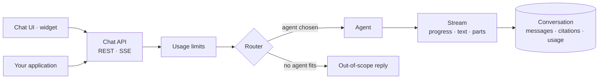
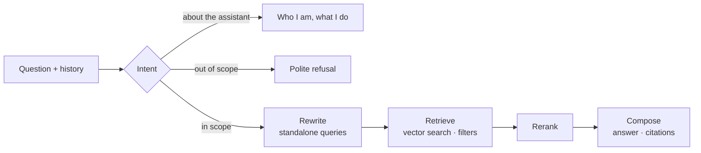
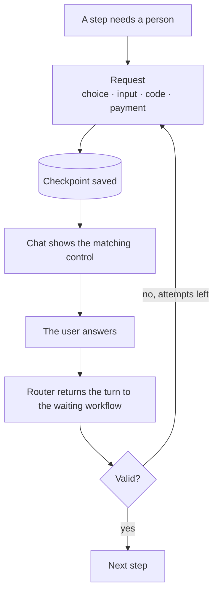
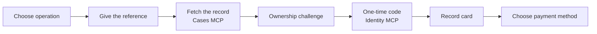
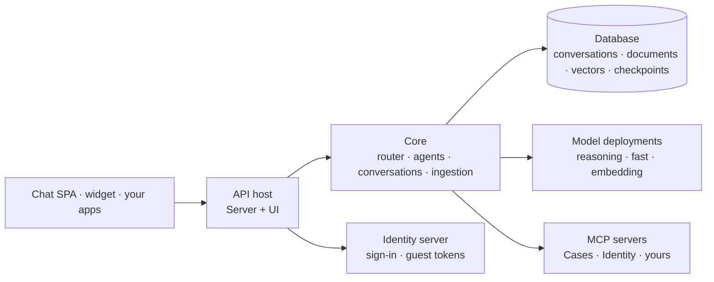

# 🤖 Indice Agents

*AI agents for assistants, self-service and automation.*

A product for building AI agents and putting them in front of people. **Agents** are the base unit: each one does
one kind of job and is registered with a description of what it does. A person writes in one conversation; a router
picks the agent that fits. Chatbots, virtual helpers, troubleshooting guides and task automation all run through the
same conversation, streaming, persistence and security pipeline.

- **Answer** — reply from your documents, policies and FAQs, with the sources shown.
- **Act** — look things up and carry out tasks in other systems through tools.
- **Guide** — take a person through a multi-step flow, stopping to ask for what it needs: a choice, a one-time
  code, a confirmation.

### 🌍 Where it fits

- **Knowledge assistants** — cited answers from product documentation, policies and FAQs, for staff or customers.
- **Customer self-service** — a visitor opens the chat on your site, proves who they are with a one-time code, sees
  their record and acts on it.
- **Guided flows & task automation** — multi-step workflows that call tools and wait for a person where one is needed.
- **Troubleshooting & virtual helpers** — an agent that asks, looks things up through tools and answers in context.
- **Inside your own products** — the embeddable widget on any page, or your own UI on the chat API.

| 📘 The product | 🛠️ For developers |
|---|---|
| 1. Core features & capabilities | 4. Architecture & hosting |
| 2. Flows | 5. Configuration & extensibility |
| 3. Where Indice Agents shines | |

---

## 🧰 1. Core features & capabilities

### ⚡ Agents — the base unit

Everything a user can ask for is handled by an agent; an agent is a piece of behaviour plus the metadata that describes it.

- **Any shape** — a single agent or a multi-step workflow, both Microsoft Agent Framework building blocks.
- **Metadata** — a name, a description and what the agent can do.
- **Built-in agents** — a knowledge agent, an operator agent for customer records, and the router.
- **Your own agents** — register one with its description; it is routed, served and listed like the built-in ones.

> An agent is "this behaviour, described this way". The description is what the router reads, so adding an agent
> does not mean touching the router.

### 🧭 Routing — one conversation, many agents

The user does not have to know which agent to talk to.

- **Explicit choice wins** — a request can name its agent; otherwise the router decides.
- **Two-stage decision** — a fast model decides first; a stronger one takes over when it is unsure.
- **Continuity** — follow-ups stay with the agent that is already handling the conversation.
- **Out of scope** — when no agent fits, the user gets a polite explanation.
- **Topic grounding** — a chat opened about a specific record goes straight to the agent that handles it.

### 📚 Knowledge & grounded answers

The knowledge agent answers from the documents you ingest, and shows where each answer came from.

- **Conversation aware** — a follow-up like "and the second one?" is understood in context.
- **Search in your database** — documents are searched by meaning, with no separate vector store to run.
- **Citations** — each answer lists its sources, with a link to the original document.
- **Strict grounding** — when the documents cannot support an answer, the assistant says so instead of improvising.
- **Taxonomy** — categories and languages are yours to define; they scope what is searched.
- **Ingestion** — add your documents to the knowledge base; private ones are shown only to signed-in users.

### 🙋 Human in the loop

A workflow can stop, ask a person, and continue from the same point when the answer arrives.

- **Typed questions** — a choice, some text, a one-time code, a payment method.
- **Durable pauses** — a paused workflow survives restarts and resumes whenever the answer comes.
- **A control per question** — the chat UI shows the matching input for each kind of question.

> The person is a step in the workflow, not an interruption of it: the same definition holds the model calls, the
> tool calls and the points where a human decides.

### 🔧 Tools & MCP

Agents act on other systems through tools, discovered over the Model Context Protocol (MCP) — and the assistant is
itself an MCP server for others.

- **Named MCP connections** — connect as many MCP servers as you need; an agent asks for one by name.
- **Discovered at run time** — tools added on a server are available without redeploying the assistant.
- **Indice products as tools** — Indice Cases and Indice Identity work as tool servers.
- **Tools in code** — tools can also be written in code and shared by every agent.
- **Exposed as an MCP server** — other assistants, IDEs and automations can call your agents and knowledge search.

### 🧩 Templates & context

What the model is told, and what it knows about the caller, are templates and settings — not code.

- **Prompt templates** — every prompt is an editable template with a built-in default.
- **Agent identity** — who the assistant is and whom it represents, in your words.
- **User context** — the model knows the caller's name, language and preferred style.
- **Localized messages** — system messages in English and Greek, each overridable.

### 🎨 Rich answers

An answer is more than text; each kind of content has its own presentation in the chat UI.

- **Text** — formatted, streamed as it is written.
- **Cards** — a record shown as a designed card.
- **Images & callouts** — images with a caption; info, success, warning and error notices.
- **Interactive parts** — buttons and choice lists the user answers with a click.

### 💬 Conversations & streaming

- **Chat API** — everything the chat UI does is an API your own UI can use.
- **Streaming** — the user sees progress per step and the answer as it is written.
- **History** — agents remember the recent turns; conversations are titled automatically.
- **Feedback** — users like or dislike an answer.

### 👤 Profiles, preferences & usage

- **Profile on first use** — created from the user's identity; no separate registration.
- **Preferences** — answer language, response style and preferred categories.
- **Consumption** — usage is tracked per message, conversation and user, and shown to the user.
- **Limits** — caps per conversation and per user.

### 🚪 Guest users

- **Anonymous chat, when you allow it** — visitors can start a conversation without signing in.
- **A real token, not an open endpoint** — a guest gets a short-lived identity from your identity server.
- **Named guests** — a page can pass a display name so the assistant addresses the visitor.

### 🖥️ Chat UI & embeddable widget

- **Chat application** — a ready chat UI: conversations, agent picker, citations and profile.
- **Branding** — theme, logo, assistant name and language.
- **Widget** — one script tag adds a chat launcher to any page.
- **Page integration** — the page can style the widget, say which record it is about and name the visitor.
- **Allowed sites** — only the sites you list can embed the widget.

### 🔐 Security & guardrails

- **Scopes and roles** — separate permissions for chatting and for managing the knowledge base.
- **Per-user data** — conversations belong to their owner; nobody else can read them.
- **Customer authentication in the chat** — an ownership challenge and a one-time code before a record is shown.
- **Data masking** — personal data is masked before it reaches the model.
- **Audit trail** — routing decisions, tool calls and human answers are recorded per conversation.
- **Tools behind the server** — tools are called by the server; credentials never reach the browser.
- **Safe by default** — inputs are validated, content is sanitized before it is shown, and errors do not leak details.

### 🧠 Models

- **Vendor agnostic** — Azure OpenAI, Azure AI Foundry, OpenAI or a locally hosted model.
- **Bring your own key** — your own deployments, key and region.
- **A model per role** — a stronger model where reasoning matters, a faster one for the supporting steps.

---

## 🔄 2. Flows

### 🔄 From message to answer

Whether the message comes from the chat UI, the widget or another application, the road is the same.



The router is the control point: an explicit agent, a workflow waiting for input, or a classification decides where
the turn goes. The turn is saved before the stream completes, so what the user saw is what the conversation holds.

### 📚 The knowledge pipeline



Rewriting and reranking are switches: turn them off for speed, keep them on for multi-turn accuracy.

### 🙋 Pause, ask, resume



### 🔄 Example: the operator agent

Built from the shipped steps: a visitor asks about a record and gets it only after proving it is theirs.



A chat opened from a page that already knows the record (the widget's reference attributes) skips the first two steps.

---

## ⭐ 3. Where Indice Agents shines

Two things set Indice Agents apart. An agent is only its own logic and a description — everything around it
(routing, streaming, persistence, human-in-the-loop, UI, limits) is already there for every agent you add; and the
product is built to face customers, not only staff. The two pillars below expand each.

### 🧩 Register an agent, get a product

- **Routable on arrival** — a new agent is picked by the router from its description.
- **Streamed and stored** — progress, text and typed parts reach the UI; turns, citations and usage are saved.
- **Human-in-the-loop included** — questions, durable pauses and UI controls work for any workflow.
- **Tools by name** — any step can use any registered MCP connection.
- **Same guardrails** — scopes, ownership, limits and guest handling apply without extra code.

### 🛡️ Built for customer-facing use

- **Guests with real tokens** — anonymous visitors, authorized through your identity server.
- **Authentication inside the conversation** — challenge and one-time code before personal data is shown.
- **Grounded and cited** — answers come from your documents, with sources; out-of-scope questions are declined.
- **One script tag** — the widget puts the assistant on any site you allow.
- **Masked and audited** — personal data is masked before the model sees it; routing, tool calls and human answers
  are on the audit trail.
- **Bounded cost** — limits on messages and tokens per conversation, and on conversations per user.

---

# 🛠️ For developers

## 🏗️ 4. Architecture & hosting

- **Built on `Indice.Platform`** — `Indice.Features.Agents.{Core, Server, UI}`, `net10.0`.
- **Standard foundations** — Microsoft Agent Framework (agents and workflows), Microsoft.Extensions.AI, ASP.NET Core Minimal APIs,
  EF Core (SQL Server 2025 vectors), the MCP C# SDK, Handlebars.Net.
- **Reference template** — `Indice.Dex`: a thin host that wires the libraries and owns configuration, prompt and card
  templates, migrations and themes.



- **One host, one database** — the API, the chat SPA and the widget loader are served by a single ASP.NET Core app.
- **In-process agents** — agents run inside the request; a paused workflow lives in the database, not in memory.

```csharp
// Indice.Dex
builder.Services.AddAgents(builder.Configuration, options => {
    options.PathPrefix = "/api";
    options.AllowAnonymousChatCreation = true;        // guests, through GuestToken settings
    options.ConfigureAgents = agents => {
        agents.ConfigureDbContext = (sp, db) => db.UseSqlServer(connectionString);
    };
});
builder.Services.AddOperatorWorkflow(builder.Configuration);   // optional: the operator agent + its MCP clients

// Your own agent: metadata + its implementation under the same name (a workflow here)
builder.Services.AddSingleton(new AgentInfo("claims", "Opens and tracks insurance claims.", ["text/plain"], ["text/markdown"]));
builder.Services.AddKeyedScoped<Workflow>("claims", (sp, key) => /* new WorkflowBuilder(...).Build() */);

var app = builder.Build();
app.UseAgentsUI(o => {                                         // chat SPA + widget
    o.Theme = "dex";
    o.AssistantName = "Dex";
    o.Widget.AllowedOrigins = ["https://www.your-site.gr"];    // sites allowed to embed the widget
});
app.MapAgents();                                               // chats · profile · agents · sources · documents
```

---

## ⚙️ 5. Configuration & extensibility

Everything that can be a setting is a setting. Code is for agents, tools and the seams below.

| Section | What it controls |
|---|---|
| `ConnectionStrings:DexDb` | the database (schema `dex`): conversations, documents, vectors, profiles, checkpoints |
| `General:Authority` / `General:Api` | host identity server and API resource configuration |
| `AgentsServerOptions.GuestToken` (configure in `AddAgents`) | guest token authority/token endpoint, client ID, client secret and scopes; not automatically bound from `General` |
| `Dex:AzureOpenAI` | endpoint, key, deployments per role, embedding dimensions |
| `Dex:Models` | temperature and output limits per role |
| `Dex:Retrieval` / `Dex:Pipeline` | candidates, results, query expansion, minimum score; rerank, rewrite and strict-grounding switches |
| `Dex:Session` | history window, auto titles, per-conversation and per-user limits and their messages |
| `Dex:Ingestion` / `Dex:Taxonomy` | chunk sizes, embedding batch size; allowed categories and languages |
| `Dex:Routing` / `Dex:SystemOne` | default agent; decision model switch and confidence threshold |
| `Dex:UI` | theme, assistant name |
| `Prompts/*.txt` · `Cards/*.hbs` | prompt templates per step, agent identity, card templates per record type |

The configuration section and database keep the `Dex` codename; the libraries are named Agents.

```text
AgentInfo + keyed Workflow     your own agents
AddMcpClient("name")           your own tool servers (HTTP / stdio, client credentials)
IPromptTemplateRenderer        where prompt templates come from
ICustomerDataResolver          map a tool's record payload, per record type
ICustomerDataCardRenderer      how a record becomes a card
IChallengeValidator            how an ownership answer is checked
ILlmReranker                   your own reranking
IUsageGuardService             your own limits and quotas
AgentMessageLocalizer          override or translate system messages
```

- **C# interfaces, not a DSL** — the team that writes ASP.NET Core writes the agents.
- **In-process** — workflows and extensions run in your host, debuggable with the rest of your app.
- **Safe defaults** — every seam ships an implementation, so a fresh host answers questions before any of them is replaced.
