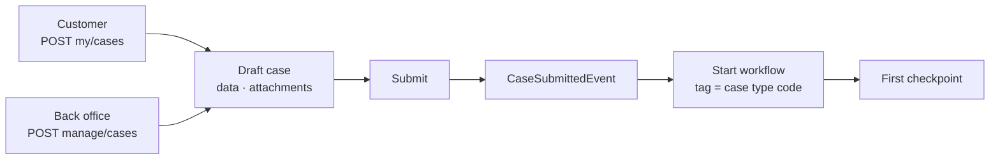
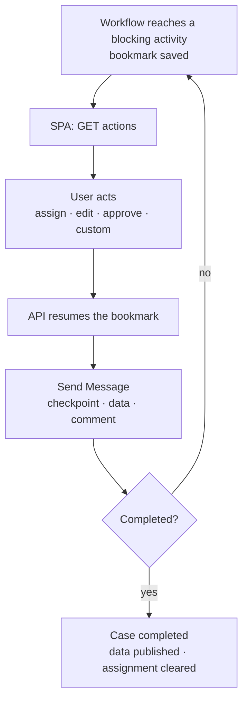
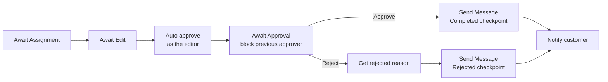
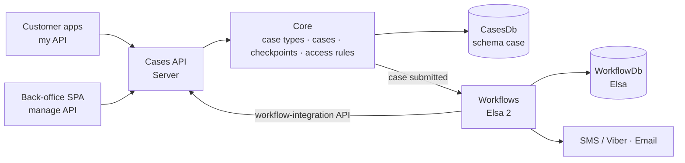

# 🗂️ Indice Cases

*Owned, case management & back-office workflows.*

A complete case management product the client deploys on their own
infrastructure. **Case types** are the base unit: each one is a JSON Schema form, a set of **checkpoints** (the
states a case moves through) and an **Elsa workflow** that decides who acts next. Customers submit cases from their
own apps, back-office staff open cases on a customer's behalf, and both kinds run through the same assignment,
edit, approval and notification pipeline — with a strict split between what the customer sees and what stays internal.

- **A deployed system, not a SaaS** — your databases, your workflows, your operations.
- **Customer and back office on one record** — the `my` API serves customers, the `manage` API serves staff; one case, two views.

### 🌍 Where it fits

- **Customer requests & applications** — forms customers submit from web or mobile apps (the `External` channel).
- **Staff-initiated cases** — branch or call-centre staff open a case on a customer's behalf (the `Managed` channel).
- **Approval-heavy processes** — assignment, maker-checker approval, rejection reasons, custom business actions.
- **Regulated back offices** — every state change, data version and comment is a row; a PDF of the case is one call away.
- **Any form-driven process** — a new process is a case type (schema + layout + checkpoints) plus a workflow, not a code change.

| 📘 The product | 🛠️ For developers |
|---|---|
| 1. Core features & capabilities | 4. Architecture & hosting |
| 2. Flows | 5. Feature internals & integration |
| 3. Where Indice Cases shines | 6. Configuration |

---

## 🧰 1. Core features & capabilities

### ⚡ Case types — the base unit

Every case belongs to a case type, and the case type carries everything that makes a process different from the next one.

- **`CaseType`** — `Code`, `Title`, `Description`, `Category`, `Order`, `Tags`.
- **`DataSchema`** — a JSON Schema; case data is validated against it on the server (`CasesJsonSchemaValidator`).
- **`Layout`** — a JSON Forms UI schema that the back-office SPA (and your customer apps) render.
- **Translations** — `Translations` for titles and descriptions, `LayoutTranslations` for the form, applied per request language (`IJsonTranslationService`).
- **`Config`** — free-form JSON per case type, e.g. `PdfOptions` (portrait, digitally signed, QR code).
- **`CanCreateRoles`** — which roles may open a case of this type; **`IsMenuItem`** — the type gets its own list
  in the back-office menu, shaped by `GridFilterConfig` / `GridColumnConfig`.
- **`CheckpointTypes`** — the states a case of this type goes through.

> A case type is "this form, these states, this process". A new process is data plus a workflow definition
> published from the designer.

### 📍 Checkpoints & status

A case's history is its list of checkpoints; its status is whatever the current checkpoint says.

- **`CheckpointType`** — `Code` (unique per case type), title, description, translations, a `Status`
  (`Submitted` · `InProgress` · `Completed` · `Deleted`) and a `Private` flag.
- **`Checkpoint`** — one row per transition, with `CreatedBy`, `CompletedDate` and `DueDate`.
- **Public vs private** — a private checkpoint is visible to the back office only; the customer keeps seeing the last
  public one (`PublicCheckpointId`). "Pending second approval" stays internal while the customer sees "In progress".
- **Completion** — moving to a `Completed` checkpoint stamps `CompletedBy`, publishes the latest data to the customer
  and clears the assignment.

### 🗃️ Cases, data & versions

- **`Case`** — `Owner` (`ContactMeta`: user id, reference such as a customer code, name, TIN), `GroupId` (branch or team),
  `Priority` (`Urgent` / `Normal`), `Channel`, a `Metadata` dictionary, `Draft` flag and `ReferenceNumber`.
- **Draft → submit** — a case starts as a draft; its data can be prefilled (`ICaseDataInitializer`), edited and given
  attachments, then it is submitted and the workflow starts.
- **Data versions** — every edit writes a new `CaseData` row; `Data` is the current version and `PublicData` is the one
  the customer sees. `publish-private-data` releases the current version on demand.
- **Reference numbers** — `ReferenceNumberEnabled` draws numbers from a database sequence (`case.ReferenceNumberSequence`).
- **Channels** — `External` (created through the `my` API), `Managed` (through the `manage` API), or any name up to
  128 characters; legacy `Customer` / `Agent` values count as `External` / `Managed` **(next release)**.
- **Comments, attachments, timeline** — private or public comments with replies; attachments stored with the case;
  a timeline that merges checkpoints and comments; related cases that share an `ExternalCorrelationKey` metadata value.

### 🔄 Workflows — Elsa 2

Each case type's process is an Elsa workflow, tagged with the case type's code and started when a case is submitted.

- **Start on submit** — `CaseSubmittedEvent` starts the published workflow definition whose tag list contains the case type code.
- **Blocking activities** — *Await Assignment*, *Await Edit*, *Await Approval* (`Approve` / `Reject` outcomes) and
  *Await Action* (a custom button with label, style, optional input and success message). Each waits as an Elsa
  bookmark until a back-office user acts, and each can be limited to an `AllowedRole`.
- **Case activities** — *Send Message* (move to a checkpoint, update data, attach a file, comment), *Assign case to user*,
  *Remove assignment*, *Get case details*, *Get channel*, *Notify customer* (bilingual EN/EL text over SMS/Viber).
- **Approval activities** — *Auto approve*, *Block previous approver* (four-eyes), *Remove previous approval*,
  *Reject reasons*, *Get rejected reason*.
- **HTTP Endpoint with validation** — external systems call into a running workflow with a schema-validated payload.
- **Elsa built-ins** — timers (Quartz), HTTP, email (SMTP), user tasks, JavaScript/Liquid expressions, and your own
  activities from `GetWorkflowAssembly`.
- **Designer** — the Elsa 2 visual designer at `/workflow`; operators edit and publish workflows without a redeploy.

> The case engine never hard-codes a process. It knows checkpoints, data and actions; the workflow decides which
> checkpoint comes next and who may act.

### 🖱️ Actions — what the back office can do right now

- **Asked, not assumed** — `GET manage/cases/{id}/actions` asks the workflow which blocking activities are waiting and returns
  `CaseActions`: `HasAssignment`, `HasUnassignment`, `HasEdit`, `HasApproval` and the list of `CustomActions`.
- **Rendered as-is** — the SPA shows exactly those: assign-to-me, the edit form, approve / reject with reject reasons,
  one button per custom action.
- **Resumed by the API** — `manage/cases/{id}/assign | edit | approve | trigger-action` resumes the matching bookmark.

> The buttons a user sees are a function of the case's live position in its workflow and the user's role — no UI code per process.

### 🔐 Access control

Three layers: what your role allows, which records you were granted, and what you own.

- **Roles → system access** — `CasesUser` reads, `CasesManager` manages, `CasesAdministrator` administers
  (case types, checkpoint types, access rules); admins and system clients pass.
- **Access rules → record access** — a rule grants a member (a user, a group or a role) an access level on a case,
  a case type, a checkpoint type, or a case at a given checkpoint. Managed through `manage/access-rules` and in the SPA.
- **Ownership** — customer endpoints serve only the caller's own cases, and a customer cannot open a `Managed` case.
- **Elevated bypass** — `ByPassAccessRulesForElevatedUsers` (default `true`) lets administrators see every case without rules.

### 🧾 Customer surface — the `my` API

- **`my/case-types`** — the case types a customer can open, with translated schema and layout.
- **`my/cases`** — create a draft, update it, upload attachments, submit, list, get, download the PDF.
- **Public view only** — the customer sees the public checkpoint, the published data and, on rejection, the reason;
  never internal steps or back-office comments.
- **Same pipeline** — a customer-submitted case starts the same workflow as a staff-created one.

### 👥 Back-office surface — the `manage` API

- **Case list** — filters (reference number, customer id / name, TIN, group, date range, case types, checkpoint types)
  and configurable columns; per-case-type lists for menu-item case types.
- **Saved queries** — each user saves their own filters (`manage/queries`).
- **Case detail** — data form, timeline, related cases, comments, attachments, PDF and the available actions.
- **Cases on behalf of a customer** — contact search through `IContactProvider` (Identity Server-backed or your own),
  data prefill through `ICaseDataInitializer`.
- **Lookups** — named `ILookupService` implementations feed form dropdowns from your systems (`manage/lookups/{name}`).
- **Notification subscriptions** — staff subscribe to case types; a workflow fetches the subscribers through the
  integration API, so it can email them.

### 📊 Dashboard & reports

- **`manage/dashboard/metrics`** — counts per status, open cases assigned to me, unassigned, stale (open and untouched
  for N days), new this week vs the previous week, and daily intake — over the cases the user can see.
- **`manage/reports`** — cases grouped by case type, status or group; optionally limited to one channel **(next release)**.
- **SPA dashboard** — status and workload cards, intake chart, and a by-type / by-status row per channel in
  `DashboardChannels` **(next release)**.

### 🖨️ PDF output

- **Two endpoints** — `manage/cases/{id}.pdf` for staff, `my/cases/{id}/download` for customers.
- **Per case type** — `Config.PdfOptions`: `IsPortrait`, `DigitallySigned`, `RequiresQrCode`.
- **Audited** — every download raises `CaseDownloadedEvent` with the channel it came from.

### 🖥️ Back-office UI — Angular SPA

A full operator surface, compiled into `Cases.UI` and served embedded from the API host.

- **Screens** — dashboard, cases list, per-case-type lists, case detail, new case and saved queries side panes,
  notifications; for administrators also case types, checkpoint types and access rules.
- **Own JSON Forms renderers** — text, textarea, number / currency, date / date-time, select, checkbox / toggle, slider,
  file upload, lookup, rich text, links, nested objects, arrays and tables, list-with-detail, categorization,
  `oneOf` / `anyOf` / `allOf`; read-only cases render as a label / value list **(next release)**.
- **Per-channel fields** — the `case-channel` UI schema option shows a field only for cases of one channel.
- **JSON editor** — case type schema, layout, translations and config are edited in a code editor with inline
  JSON errors **(next release)**.
- **Localized** — English and Greek, switchable at runtime; strings come from server resources at
  `{prefix}/cases-i18n.{lang}.json` and can be overridden with `AddTranslationsResource` (see `i18n.md`).

---

## 🔄 2. Flows

### 🔄 From draft to running workflow

Whether a customer submits from their app or a staff member opens a case on their behalf, the road is the same.



A draft is invisible to the workflow engine: nothing runs until submit. Every data save is validated against the case
type's schema and kept as a new version. Submit clears the draft flag, raises `CaseSubmittedEvent`, and the workflow
engine starts the published definition tagged with the case type's code. From then on the workflow owns the case's position.

### 🔄 The back-office action loop

Every step that needs a person is a blocking activity; the SPA asks what is waiting and the user's click resumes it.



### 🔄 Example: a maker-checker workflow

Built only from the shipped activities: one user prepares the case, a different user approves it.



*Auto approve* records the editor as the first approver; *Block previous approver* on the next *Await Approval* stops
that same user from approving again. The four-eyes rule is part of the workflow definition, not a convention.
*Reject reasons* supplies the list the approver picks from, translated for the customer.

---

## ⭐ 3. Where Indice Cases shines

Two things set Indice Cases apart. A process is data (a schema, checkpoints and a workflow) rather than code; and the
line between what the customer sees and what the back office works on is built into the model rather than left to
each screen. The two pillars below expand each.

### 🧭 Processes as data

A new process does not need a new screen, a new table or a new deployment.

- **Schema-driven forms** — JSON Schema + JSON Forms layout, validated on the server, rendered by the SPA.
- **Checkpoints as states** — public and private states per case type, each mapped to a status.
- **Workflows in a designer** — Elsa 2 with case-aware activities; publish without a redeploy.
- **Actions from the workflow** — the back office's buttons come from the waiting activities, not from UI code.
- **Translated end to end** — case types, checkpoints, forms and UI strings per language.

### 🛡️ Built for customer-facing back offices

- **Public / private split** — customers see public checkpoints and published data only.
- **Three-layer access** — role, record-level access rules, ownership.
- **Four-eyes approvals** — *Block previous approver* and role-limited *Await Approval* in the workflow definition.
- **Full history** — checkpoints, data versions, comments and approvals are rows; the timeline is a query.
- **Two channels, one pipeline** — self-service and staff-assisted cases share workflows, reports and the dashboard.

### ✅ Capability summary

One grid to take to your team — the capability on the left, the mechanism that delivers it on the right.

| Capability | How it's delivered |
|---|---|
| Schema-driven case forms | ✅ JSON Schema + JSON Forms layout per case type |
| Public / private states and data | ✅ `Private` checkpoints, `PublicData` versions |
| Visual workflow designer | ✅ Elsa 2 at `/workflow` |
| Assignment, edit, approval, custom actions | ✅ blocking activities + `CaseActions` |
| Four-eyes approval | ✅ *Block previous approver* |
| Reject reasons, translated | ✅ *Reject reasons* / *Get rejected reason* |
| Customer self-service API | ✅ `my/cases`, `my/case-types` |
| Staff-created cases for a customer | ✅ `manage/cases` + `IContactProvider` |
| Record-level access rules | ✅ case · case type · checkpoint type · user / group / role |
| Role-based access levels | ✅ `CasesUser` · `CasesManager` · `CasesAdministrator` |
| Human-readable reference numbers | ✅ DB sequence (`ReferenceNumberEnabled`) |
| Data versions, comments, attachments, timeline | ✅ rows in `CasesDb` |
| Saved queries | ✅ per user |
| Dashboard metrics and grouped reports | ✅ `manage/dashboard/metrics`, `manage/reports` |
| PDF per case type | ✅ Razor template + pluggable `ICasePdfService` |
| Customer notification | ✅ *Notify customer* (SMS / Viber), Elsa email |
| Lookups from your systems | ✅ named `ILookupService` |
| Embedded back-office SPA | ✅ `UseCasesUI` |
| English / Greek UI, runtime switch | ✅ server-side resources + `cases-i18n` endpoint |

---

# 🛠️ For developers

## 🏗️ 4. Architecture & hosting

- **Built on `Indice.Platform`** — `Indice.Features.Cases.{Core, Server, Workflows, UI}`.
- **Standard foundations** — ASP.NET Core Minimal APIs, EF Core (SQL Server), Elsa Workflows 2, JSON Schema + JSON Forms.

### 🏗️ 4.1 High-level architecture

Composable feature libraries in one host; the case engine and the workflow engine talk to each other over an HTTP contract.



### 🏭 4.2 What's deployed in production

- **One host** — API + back-office SPA + Elsa workflow server and designer in a single ASP.NET Core app.
- **Two databases** — `CasesDb` (schema `case`) for cases, `WorkflowDb` for Elsa definitions, instances and bookmarks.
- **An HTTP seam between the engines** — the case engine calls `api/workflow-actions/*`, the workflow engine calls
  `{prefix}/manage/workflow-integration/*`, both with client-credentials tokens, even inside one process.
  `Endpoints:ServerLoopbackUri` overrides the address they use.
- **Hosted services** — database initializers for both contexts, the Elsa retention sweep, and Quartz for workflow timers.
- **Workflow designer at `/workflow`** — the Elsa 2 designer behind OIDC (`cases-ui` client), open to admins,
  `CasesAdministrator` and system clients.
- **Distributed cache** — memory by default, Redis when `ConnectionStrings:Redis` is set; holds per-user access decisions.

> One deployable, two stores: cases and workflow state are separate databases with separate migrations, so a
> workflow upgrade never touches case data.

### 🔧 4.3 Composition + reference template

```csharp
// Indice.Cases/Program.cs
builder.AddCaseServer(options => {
    options.PathPrefix = "/api";
    options.ReferenceNumberEnabled = true;           // human-readable case numbers from a DB sequence
    // options.ConfigureDbContext = …;               // defaults to ConnectionStrings:CasesDb (SQL Server)
    // options.UseContactProviderIdentity(o => …);   // search customers in your Identity Server
});
builder.AddCasesWorkflow(options => {
    options.RegisterAuthentication = true;           // OIDC sign-in for the workflow designer
    options.ConfigureSmtp = builder.Configuration.GetSection("Elsa:Smtp").Bind;
    // options.GetWorkflowAssembly = () => typeof(Program).Assembly;  // code-first workflows + custom activities
});

var app = builder.Build();
app.UseCasesWorkflow();   // Elsa HTTP activities, designer (/workflow), workflow-actions API
app.UseCasesUI();         // embedded back-office SPA
app.MapCases();           // my + manage + workflow-integration + translation endpoints
```

---

## 🧩 5. Feature internals & integration

### 🔐 Access control

- **Pluggable** — `AddCaseAuthorizationService<T>()` adds your own `ICaseAuthorizationService` to filter lists and decide membership.
- **Cached** — per-user, per-case access decisions are cached for five minutes (sliding).

### 🖨️ PDF output

- **Template** — `ICaseTemplateService` renders the Razor view `Cases/Pdf/{CaseTypeCode}` through `IHtmlRenderingEngine`.
- **Engine** — `ICasePdfService.HtmlToPdfAsync` turns the HTML into a PDF. The default is a no-op; the host plugs in its engine.

### 🖥️ Back-office UI — Angular SPA

- **Served in-process** — `UseCasesUI()` streams the packaged bundle; OIDC client `cases-ui`, scope `cases`.
- **Redesigned** — Tailwind 4 + daisyUI 5, Lucide icons, Angular signals **(next release)**.

### 🧩 Events & integration

- **Platform events** — `CaseSubmittedEvent`, `CaseMessageCreatedEvent`, `CaseMessageSentEvent`, `CaseDownloadedEvent`;
  subscribe with `AddCaseEventHandler<TEvent, THandler>()`.
- **Workflow integration API** — `manage/workflow-integration/*`: get a case, patch data (merge or JSON Patch) and metadata,
  attach files, add or roll back approvals, assign, send messages, publish data, list subscribers.
- **`ICasesManager`** — the workflow-side client of that API, for your own activities.

---

## ⚙️ 6. Configuration

Everything that can be a setting is a setting. Code is for the seams: contacts, lookups, PDF, authorization, activities.

| Section | What it controls |
|---|---|
| `ConnectionStrings` | `CasesDb` (SQL Server, schema `case`), `WorkflowDb` (Elsa), optional `Redis` |
| `General:Authority` / `General:Api` | identity server, `cases` resource, introspection secret, loopback `ClientId` / `ClientSecret` |
| `Endpoints:ServerLoopbackUri` | the address the case and workflow engines use to call each other |
| `Elsa:Smtp` | SMTP for Elsa's email activity |
| `CaseServerOptions` | path prefix, scope, claim types, reference numbers, access-rule bypass, upload limits, translations |
| `CasesWorkflowOptions` | workflow database, SMTP, retention, HTTP activities path, designer authentication, code-first workflows |
| `CasesUIOptions` | list columns and filters, dashboard tags and channels, language |

### 🔌 Server

```csharp
builder.AddCaseServer(options => {
    options.PathPrefix = "/api";
    options.RequiredScope = "cases";
    options.ReferenceNumberEnabled = true;
    options.ByPassAccessRulesForElevatedUsers = true;
    options.GroupIdClaimType = "group_id";          // branch / team of the back-office user
    options.DatabaseSchema = "case";
    options.MapTranslations = true;                  // {prefix}/cases-i18n.{lang}.json + {prefix}/languages
    options.ConfigureLimitUpload = o => {
        o.DefaultMaxFileSizeBytes = 10 * 1024 * 1024;
        o.DefaultAllowedFileExtensions = [".pdf", ".jpg", ".png"];
        o.EnableMagicByteValidation = true;
    };
    options.UseContactProviderIdentity(o => { o.ClientId = "…"; o.ClientSecret = "…"; });
});
```

- **Reference numbers** give staff and customers something to say on the phone instead of a GUID.
- **Group claim** ties a back-office user to a branch or team, which access rules and filters use.
- **Upload limits** — size, extension allow-list and magic-byte checks on every attachment.

### 🔀 Workflows

```csharp
builder.AddCasesWorkflow(options => {
    options.ConfigureSmtp = builder.Configuration.GetSection("Elsa:Smtp").Bind;
    options.RetentionServicesEnabled = true;       // default: completed instances, 30-day TTL, swept every 4 days
    options.ConfigureRetentionServices = o => o.TimeToLive = Duration.FromDays(90);
    options.ServerHttpActivitiesBasePath = "/http-activities";
    options.RegisterAuthentication = true;         // OIDC for the designer
    options.WorkflowUIClientId = "cases-ui";
    options.GetWorkflowAssembly = () => typeof(Program).Assembly;
});
```

- **Retention** keeps `WorkflowDb` bounded; completed workflow instances are swept on a schedule.
- **Code-first or designer** — workflows can be authored in the designer or shipped in your assembly with custom activities.
- **SMS** — *Notify customer* sends through `ISmsService`; the default is a no-op, so register a provider in the host.

### 🖥️ Back-office UI

```csharp
app.UseCasesUI(o => {
    o.CaseListColumns = [CaseListColumn.ReferenceNumber, CaseListColumn.CustomerName, CaseListColumn.CaseType,
                         CaseListColumn.CheckpointType, CaseListColumn.AssignedTo, CaseListColumn.SubmitDate];
    o.CaseListFilters = [CaseListFilter.ReferenceNumber, CaseListFilter.CustomerName,
                         CaseListFilter.DateRange, CaseListFilter.CaseTypeCodes];
    o.DashboardChannels = ["Managed", "External"];  // (next release) one report row per channel; [] hides them
});
```

- **Shape the list per deployment** — a bank shows TIN and customer id; an internal helpdesk hides them.
- **Per case type** — menu-item case types get their own columns and filters from `GridColumnConfig` / `GridFilterConfig`.

### 🔐 Identity provisioning

- **API resource** `cases` with the claims `role`, `email`, `name`, `sub`, `given_name`, `family_name`.
- **Client** `cases-ui` (authorization code) for the back-office SPA and the workflow designer; identity resources
  `openid`, `profile`, `email`, `role`, plus `cases` and `offline_access`.
- **Roles** — `CasesUser`, `CasesManager`, `CasesAdministrator`; `Admin` passes everything.
- **Loopback client** — a client-credentials client with the `cases` scope (`General:Api:Secrets:ClientId` / `ClientSecret`).

### 🗄️ Databases & migrations

- **Two contexts** — `CasesDbContext` and Elsa's `ElsaContext`, each with its own migrations history table.
- **Your migrations assembly** — the template's `README.md` shows the `MigrationsAssembly` / `MigrationsHistoryTable`
  setup and the `dotnet ef migrations add --context …` commands.
- **Upgrade scripts** — schema changes between versions ship as SQL in the Cases changelogs.

### 🧰 Extensibility

The C# seams where your code plugs into the product without forking anything.

```text
IContactProvider              customer search for staff-created cases (Identity Server built in)
ICaseDataInitializer          prefill a new case's data from your systems
ILookupService                named dropdown sources (AddLookupService<T>("name"))
ICaseAuthorizationService     extra list filtering and membership (AddCaseAuthorizationService<T>())
ICasePdfService               your HTML-to-PDF engine
ICaseTemplateService          your PDF template rendering (default: Razor view per case type)
IPlatformEventHandler<TEvent> react to submitted / message / downloaded events (AddCaseEventHandler)
CasesMessageDescriber         override the product's messages (AddCasesMessageDescriber<T>())
Elsa activities + bookmarks   custom workflow steps from your assembly (GetWorkflowAssembly)
AddTranslationsResource       override or extend the back-office UI strings
```

- **C# interfaces, not a DSL** — the team that writes ASP.NET Core writes the extensions.
- **In-process** — extensions run in your host, debuggable with the rest of your app.
- **Safe defaults** — every seam ships a no-op, so a fresh host runs before any of them is implemented.
