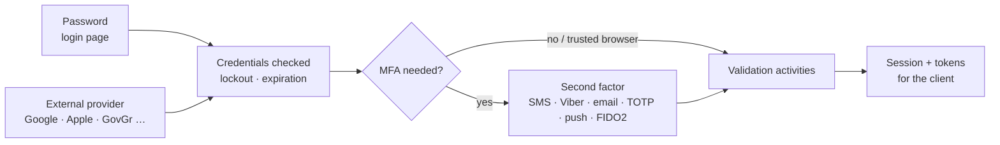
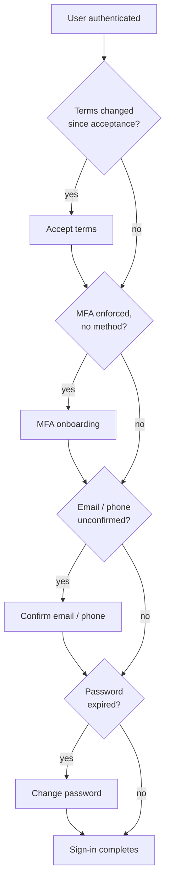
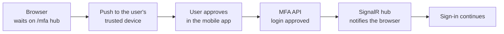
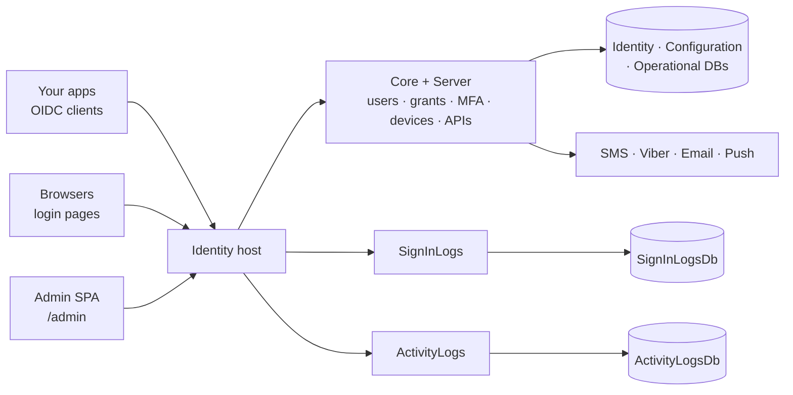

# 🆔 Indice IAM

*Owned, .NET-native identity & access management.*

A complete identity product the client deploys on their own infrastructure. **Users** are the base unit: each one
signs in through one **sign-in pipeline** (password or external provider, then MFA, then the post-login validation
activities) and receives tokens for the **clients** (OIDC applications) and **APIs** you register. Workforce, partners
and customers sign in through the same pipeline, are audited by the same logs and follow the same MFA and device-trust
rules.

- **A deployed system, not a SaaS** — your databases, your signing keys, your delivery accounts, your operations.
- **Built on standard foundations** — ASP.NET Core Identity stores the users, Duende IdentityServer speaks OIDC / OAuth2;
  Indice adds the grants, MFA, devices, audit and UI on top.

### 🌍 Where it fits

- **Workforce** — sign-on into internal and back-office apps, role-based access, enforced MFA.
- **B2C** — public registration, social logins, branded sign-in pages, self-service profile.
- **B2B & partners** — federated logins, API clients with their own users, delegated (on-behalf-of) access.
- **Mobile & devices** — device registration, trusted devices, push approval, device-secret authentication.
- **Regulated & public sector** — GovGr (TaxisNet) login, terms re-acceptance, two audit trails, data in your own database.

| 📘 The product | 🛠️ For developers |
|---|---|
| 1. Core features & capabilities | 4. Architecture & hosting |
| 2. Flows | 5. Feature internals & integration |
| 3. Where Indice IAM shines | 6. Configuration |

---

## 🧰 1. Core features & capabilities

### ⚡ Users & accounts — the base unit

Everything starts at a user record: an ASP.NET Core Identity user, extended with the state a real deployment needs.

- **`User`** — email / phone (with confirmation state), claims, roles, password history and expiration, MFA policy,
  blocked flag, devices, `TermsAcceptedDate`.
- **Claims as data** — `ClaimType` definitions (`api/claim-types`) describe which user claims exist, which are
  required and which users may edit; your own claim types are rows, not code.
- **Roles** — managed through `api/roles`; the management APIs use them together with API scopes.
- **Seeded on first run** — initial users, roles and custom claims come from the host
  (`InitialUsers`, `CustomRoles`, `CustomClaims`).
- **Avatars** — profile pictures in several sizes and formats (`jpg`, `png`, `webp`); an initials image is drawn when
  the user has not uploaded one.

### 🔑 Sign-in & sessions

- **Username + password** — the Razor Pages login, with lockout, password expiration and history.
- **External providers** — Apple, Google, Microsoft (tenant-aware), Facebook and GovGr ship wired in the template; each
  turns on when its keys are set. Any standard OIDC / OAuth2 provider can be added. External users can be
  auto-provisioned (per provider) or associated with an existing account.
- **Server-side sessions** — `EnableServerSideSessions` stores the session in the database; the cookie only holds a
  reference, so a session is revoked by deleting it.
- **Single active session** — `EnforceSingleActiveSession` ends a user's older sessions when they sign in again.
- **Remember me & trusted browsers** — "remember login" duration, and an MFA-trusted-browser cookie with sliding or
  absolute expiration.

> A session is a row you can see and delete. "Sign this user out everywhere" is an operation, not a wait for tokens to expire.

### 🎫 Custom grants

Five grant types ship on top of the standard OIDC / OAuth2 flows; the same `IExtensionGrantValidator` seam is open to you.

| Grant | `grant_type` | Purpose |
|---|---|---|
| TOTP | `totp` | Exchange an OTP for a token — step-up for a client that already holds the user's identity |
| OTP authenticate | `mfa` | Complete a password sign-in with a one-time code |
| Device authentication | `device_authentication` | A registered device signs in with its own secret (mobile apps, kiosks) |
| Delegation | `delegation` | Act on behalf of a user, for back-office and service-to-service calls |
| Guest | `urn:indice:guest` | Anonymous app installs get a token for the APIs open to guests (`AddGuestGrantValidator`) |

### 📱 Multi-factor authentication

Six methods, chosen per deployment in one builder.

- **Methods** — SMS, Email, Viber, Authenticator app (TOTP), Trusted device (push approval) and FIDO2 / WebAuthn
  (security keys and platform authenticators).
- **Push approval** — the browser waits on the `/mfa` SignalR hub; the user approves or rejects on their trusted device.
- **Policy** — `Optional` (users opt in from their profile) or `Enforced` (MFA from the first sign-in), globally and per user.
- **Trusted browsers** — remembered for `RememberDurationInDays`, sliding or absolute, optionally across sessions.
- **Conditional step-up** — `RequireWhen.UserHasTrustedBrowserButExpiredPassword` asks for MFA again when the password
  has expired, even on a trusted browser.
- **No downgrade** — `AllowDowngradeAuthenticationMethod: false` stops a user from falling back to a weaker method.

### 📲 Devices & trust

Devices are records with a trust state, a push registration and a lifecycle.

- **Device API** — `api/my/devices` for the user (register, update, delete, request trust); `api/devices` for administrators.
- **Trust activation delay** — a device asks for trust and becomes trusted only after `TrustActivationDelay` (48 hours
  in the template), so stolen credentials cannot trust a new device straight away.
- **Limits** — default and maximum registered devices, maximum trusted devices; the user can change their own cap
  within the maximum.
- **Push** — device registrations go to Azure Notification Hubs (APNS / FCM) for MFA approvals and notifications.
- **Password after profile change** — `RequirePasswordAfterUserUpdate` asks for the password again after a sensitive update.
- **Events** — `DeviceCreatedEvent`, `DeviceUpdatedEvent`, `DeviceDeletedEvent`, `DeviceTrustRequestedEvent`.

### 🚦 Post-login validation pipeline

After the credentials check and before the sign-in completes, the user runs through a chain of activities. Each one
either sends the user to a page or passes to the next.

- **`RequiresTermsAcceptanceActivity`** — the user accepted the terms before `TermsLastModifiedDate`, or never.
- **`RequiresMfaOnboardingActivity`** — MFA is enforced and the user has no method yet.
- **`RequiresEmailVerificationActivity`** / **`RequiresPhoneNumberVerificationActivity`** — email or phone not confirmed.
- **`RequiresPasswordChangeActivity`** — the password has expired under `PasswordExpirationPolicy`.
- **Your own** — implement `IIdentityValidationActivity` for a KYC step, a consent step, missing profile data.

> Onboarding and compliance live in one ordered chain. Changing the terms is a date in configuration; the next sign-in
> of every affected user goes through acceptance before a token is issued.

### 🛡️ Hardening

- **Rate limiting** — 20 per-endpoint rules in the template's `appsettings.json` (login, register, forgot-password,
  TOTP, every `my/account` change endpoint …), each with its own limit, window and HTTP method.
- **Action guard** — a separate attempt counter for sensitive actions (default 5 attempts per 24 hours).
- **reCAPTCHA** — v3 (invisible, score-based) on login, register and forgot-password, falling back to the v2 checkbox
  when the score is below `ScoreThreshold`.
- **Lockout** — failed-attempt limit and lockout duration, applied to new users too.
- **Password rules** — length and character classes, history (`PasswordHistoryLimit`), blacklist, "not the username"
  (`MaxAllowedUserNameSubset`), `NonCommonPasswordValidator`, allowed / Unicode character validators.
- **Blacklists** — disposable email domains and specific phone numbers are rejected (`EmailBlacklist`, `PhoneBlacklist`).
- **Headers & keys** — a configurable Content Security Policy, data-protection keys in Azure Storage or on disk, token
  signing from your own PFX.
- **Security notifications** — users are told about security-relevant changes to their account (can be switched off).

### 📊 Sign-in logs & impossible travel

An audit trail of every sign-in attempt, written off the request path.

- **Captured from IdentityServer events** — successful and failed logins, optionally token and password events.
- **Enriched** — device, location (IP → country and coordinates), request id, session id, sign-in type, subject name.
- **Anonymisation** — `AnonymizePersonalData` strips personal data from entries when turned on.
- **Impossible travel** — the speed between two sign-ins is checked against `AcceptableSpeed` (400 km/h by default);
  on a hit the user is either asked for MFA (`PromptMfa`, default) or refused (`DenyLogin`).
- **Retention** — entries older than 90 days (default) are deleted in batches every hour.
- **Queryable** — a sign-in logs API and admin UI screens with filters, a map and dashboard series.

### 📝 Activity logs

A second audit trail, of what changed rather than who signed in.

- **From platform events** — `IdentityEventsActivityLogConverter` turns identity events (user created, email or
  password changed, client created or updated, devices, blocks …) into activity entries.
- **Own database** — `ActivityLogsDb`, with its own queue, enrichers and retention.
- **Your events too** — write an `IActivityLogFromEventConverter` for your own platform events.

> Two logs because they answer two questions: the sign-in log is one row per attempt (fraud, support, travel checks);
> the activity log is one row per change (audit, compliance). Each can sit on the storage tier that suits it.

### 🧾 Self-service — the `my/account` API

What a signed-in user can do from your apps, without the back office.

- **Profile** — claims (`my/account/claims`), picture, password, password expiration policy.
- **Email & phone** — change with confirmation (link or OTP), resend confirmation.
- **Grants** — list and revoke the applications the user has consented to.
- **Devices** — register, trust and remove their devices; change their own device cap.
- **Account** — block or delete their own account.
- **Public helpers** — `account/register`, `account/forgot-password`, `account/username-exists`,
  `account/validate-password`, `account/password-options`, `account/calling-codes` (all rate-limited).

### 🎨 Branding, theming & localization

- **Razor Class Library** — every page can be overridden by a file with the same path in the host project; static
  files in the host's `wwwroot` win over the library's.
- **Two UI frameworks** — `Bootstrap5` or `Tailwind`, chosen with `<IdentityUIFrameworkVersion>` in the `.csproj`.
- **Themes** — `Minimal`, `Split` (default), `Columns`, `Panel` or your own, as a set of `--idui-*` CSS variables
  **(next release)**.
- **Per-client theming** — a client can carry its own theme config, applied to the pages it sends users to
  (`ClientThemeAttribute`, `ClientThemingService`).
- **Footer links** and **email confirmation by OTP** (`EmailConfirmationMethod.Otp`) **(next release)**.
- **Legal pages** — terms and privacy policy are Markdown files in `wwwroot/legal`, per language.
- **Localization** — Greek, Spanish, Italian and Japanese resources ship (German, French, Portuguese partially); the
  template enables English and Greek, picked from the query string, `ui_locales` or a cookie.

### ⚙️ Runtime settings

- **`api/app-settings`** — administrators read, add, update and delete settings stored in the database; the host reads
  them at startup (`AddDatabaseSettings`), on top of `appsettings.json`.
- **Bootstrap** — `api/app-settings/load` copies `appsettings.json` into the database on first deploy.

### 🖥️ Admin UI — Angular SPA

An operator surface served embedded from the identity host, signing in through the same pipeline as everyone else.

- **Mounted at `/admin`** — OIDC client `idsrv-admin-ui`, scopes `identity`, `identity:clients`, `identity:users`, `identity:logs`.
- **Screens** — users (claims, roles, devices, MFA, blocks), roles, clients, API and identity resources, scopes, claim
  types, sign-in logs, activity logs, settings, dashboard.
- **Same rules for operators** — admins are subject to the same MFA, device and audit rules as end users.

---

## 🔄 2. Flows

### 🔄 From credentials to token

Whatever the user signs in with, the road to a token is the same.



The trusted-browser cookie skips the second factor, unless a rule such as an expired password asks for it again.
Every attempt, successful or not, is queued to the sign-in log without slowing the response.

### 🔄 The post-login validation chain



Each check is its own activity class; the order is the chain's order, and your own activities slot into it.

### 🔄 Example: push approval from a trusted device



The device that approves must already be trusted — and trust only arrives after the activation delay, so a phished
password alone cannot approve its own sign-in.

---

## ⭐ 3. Where Indice IAM shines

Two things set Indice IAM apart. The whole sign-in journey — grants, MFA, onboarding steps, audit — runs as .NET code
in your own process, extensible with C# classes rather than a policy language; and the protections regulated,
customer-facing deployments need (device trust, impossible travel, two audit trails, revocable sessions) ship as
switches rather than projects. The two pillars below expand each.

### 🧭 Your identity, your code

- **An ASP.NET Core app** — the identity server is a regular host; set a breakpoint in the sign-in path and step through it.
- **Standard parts** — ASP.NET Core Identity and Duende IdentityServer; your team's existing knowledge applies.
- **Extensible by class** — a new grant, a new onboarding step, a new audit field or a new MFA method is one class.
- **Pages you own** — any page can be replaced by a Razor file in the host, without forking the library.
- **Data you own** — users, sessions and logs live in your SQL databases, migrated with EF Core.

### 🛡️ Built for regulated, customer-facing identity

- **Device trust with a delay** — a new device is not trusted until the activation window passes.
- **Impossible travel** — prompt for MFA or deny, per deployment.
- **Two audit trails** — sign-in logs and activity logs, each with its own store and retention.
- **Revocable sessions** — server-side sessions and single active session are two switches.
- **Terms re-acceptance** — one date in configuration sends every affected user through acceptance.
- **Regional channels** — Viber OTP and Greek SMS gateways next to the global providers; GovGr login built in.

### ✅ Capability summary

One grid to take to your team — the capability on the left, the mechanism that delivers it on the right.

| Capability | How it's delivered |
|---|---|
| OIDC / OAuth2 server | ✅ Duende IdentityServer + ASP.NET Core Identity |
| Social, enterprise and GovGr logins | ✅ Apple · Google · Microsoft · Facebook · GovGr |
| Custom grants | ✅ `totp` · `mfa` · `device_authentication` · `delegation` · `urn:indice:guest` |
| Six MFA methods incl. push and FIDO2 | ✅ `AddAuthenticationMethods` |
| Optional / enforced MFA, trusted browsers | ✅ `IdentityOptions:SignIn:Mfa` |
| Device registration and delayed trust | ✅ `api/my/devices` + `TrustActivationDelay` |
| Post-login onboarding chain | ✅ `IIdentityValidationActivity` |
| Server-side and single active sessions | ✅ `EnableServerSideSessions`, `EnforceSingleActiveSession` |
| Per-endpoint rate limiting | ✅ 20 rules in `IdentityServer:RateLimiter` |
| reCAPTCHA v3 with v2 fallback | ✅ `Recaptcha` section |
| Password policy, history, expiration, blacklists | ✅ `IdentityOptions:Password` + validators |
| Sign-in audit with geo and impossible travel | ✅ `AddSignInLogs` |
| Entity-change audit | ✅ `AddActivityLogs` |
| Self-service account API | ✅ `my/account/*` |
| Runtime settings in the database | ✅ `api/app-settings` |
| Bootstrap5 / Tailwind pages, per-client themes | ✅ Razor Class Library + `ClientThemingService` |
| Embedded admin SPA | ✅ `UseAdminUI` |

---

# 🛠️ For developers

## 🏗️ 4. Architecture & hosting

- **Built on `Indice.Platform`** — `Indice.Features.Identity.{Core, Server, SignInLogs, UI, AdminUI}` and `Indice.Features.ActivityLogs`.
- **Standard foundations** — ASP.NET Core (Razor Pages + Minimal APIs), ASP.NET Core Identity, Duende IdentityServer
  (IdentityServer4 on .NET 8), EF Core (SQL Server), SignalR.
- **Reference template** — `Indice.IdentityPages` (`dotnet new`), a complete production wiring of the libraries.

### 🏗️ 4.1 High-level architecture

Composable feature libraries in one host; the host talks directly to its databases and delivery providers.



### 🏭 4.2 What's deployed in production

- **One host** — login pages, OIDC endpoints, management APIs, MFA hub and admin SPA in a single ASP.NET Core app.
- **Five databases** — `IdentityDb` (users), `ConfigurationDb` (clients, resources), `OperationalDb` (grants, sessions,
  keys), `SignInLogsDb`, `ActivityLogsDb`. They can share a server or live apart.
- **Hosted services** — `PersistLogsHostedService` (drains the sign-in log queue), `LogCleanupHostedService`
  (retention), the activity-log equivalents; `FastTokenCleanupService` optionally replaces Duende's token cleanup.
- **MFA hub at `/mfa`** — in-process SignalR, or Azure SignalR when `ConnectionStrings:SignalRService` is set.
- **Shared state** — distributed cache in Redis, SQL Server or memory; data-protection keys and files in Azure Storage
  when `StorageConnection` is set, on disk otherwise.
- **Health checks** — SQL Server (or PostgreSQL) and Blob storage.

> One deployable, five stores: identity data sits on your most protected tier, sign-in logs on storage you query
> daily, activity logs on cheaper storage with longer retention.

### 🔧 4.3 Composition + reference template

```csharp
// Indice.IdentityPages/Program.cs (trimmed)
builder.Services.AddIdentityUI(builder.Configuration, options => {
    options.EnableRegisterPage = true;
    options.AutoProvisionExternalUsers = false;
});
builder.Services
       .AddExtendedIdentityServer(builder.Configuration, builder.Environment, options => {
           options.InitialUsers = UsersSeed.GetInitialUsers();
           options.EnableServerSideSessions = true;
           options.EnforceSingleActiveSession = true;
       })
       .AddGuestGrantValidator()
       .AddExtendedEndpoints(options => options.DisableCache = true)   // management + my/account APIs
       .AddDatabaseSettingEndpoints()                                  // api/app-settings
       .AddDeviceEndpoints(options => options.UsePushNotificationsServiceAzure())
       .AddSignInLogs(options => options.UseEntityFrameworkCoreStore(/* SignInLogsDb */))
       .IdentityBuilder
       .AddAuthenticationMethods(methods => methods.UseInMemoryProvider(m => m
           .AddSms().AddEmail().AddViber().AddAuthenticatorApp().AddTrustedDevice().AddFido2()));
builder.Services.AddActivityLogs(builder.Configuration)
       .ListenToPlatformEvents<IdentityEventsActivityLogConverter>()
       .UseEntityFrameworkCoreStore(/* ActivityLogsDb */);

var app = builder.Build();
app.UseRateLimiter();
app.UseIdentityServer();
app.UseAdminUI(options => options.PathPrefix = "admin");
app.MapIdentityServer();                  // management, account and device APIs
app.MapRazorPages();                      // login, register, MFA, profile pages
app.MapMultiFactorAuthentication();       // MFA API
app.MapMultiFactorAuthenticationHub();    // /mfa SignalR hub
```

---

## 🧩 5. Feature internals & integration

### 🔑 Sign-in

- **Password grant** — `ExtendedResourceOwnerPasswordValidator` applies the same lockout, MFA and blocked-user rules as
  the login page; the `mfa` grant completes it with an OTP.
- **Authentication methods** — `AddAuthenticationMethods` registers the methods the UI offers; `Add<TMethod>()` adds your own.
- **Push approval** — the MFA API (`MapMultiFactorAuthentication`) receives the device's answer and signals the waiting
  browser through the hub.

### 📊 Sign-in logs

- **Event sink** — `SignInLogEventSink` hooks into IdentityServer's event pipeline and enqueues entries.
- **Bounded queue** — capacity 100, drained in batches by `PersistLogsHostedService`; a sign-in never waits on the write.
- **Enrichers** — device, user device, location, request id, session id, sign-in type, subject name, anonymisation;
  `AddSignInLogEnricher<T>()` adds your own `ISignInLogEntryEnricher`.
- **Geography** — locations are stored as spatial points (NetTopologySuite); the impossible-travel detector reads them back.

### 📝 Activity logs

- **Converter** — `IActivityLogFromEventConverter` maps a platform event to an entry; `ListenToPlatformEvents<T>()` wires it.
- **Same shape** — queue, enrichers (`IActivityLogEntryEnricher`), cleanup and API prefix, configured separately.

### 🧩 Events

- **Platform events** — `UserCreatedEvent`, `UserUpdatedEvent`, `UserDeletedEvent`, `UserBlockedEvent`,
  `UserUnBlockedEvent`, `UserEmailChangedEvent`, `EmailConfirmedEvent`, `PhoneNumberConfirmedEvent`,
  `PasswordChangedEvent`, `AccountLockedEvent`, `ClientCreatedEvent`, `ClientUpdatedEvent`, `Device*Event`,
  `TwoFactorPreferenceChangedEvent`, `SecurityNotificationEvent`, login success / failure events and more.
- **Subscribe** — implement `IPlatformEventHandler<TEvent>`; activity logs are one subscriber among others.

### 🌐 APIs

- **Management** (`api/…`, scope `identity` + sub-scopes) — `users`, `roles`, `clients`, `resources`, `claim-types`,
  `devices`, `dashboard`, `lookups`, `app-settings`, `totp`.
- **User** — `my/account/*`, `my/devices`; public `account/*` helpers.
- **Docs** — OpenAPI document with Scalar UI (Swagger UI on .NET 8) when enabled.

### 🖥️ Admin UI

- **Served in-process** — `UseAdminUI()` streams the packaged Angular bundle from the identity host; no separate deployment.
- **Configurable** — path prefix, authority, scopes, static-file caching.

---

## ⚙️ 6. Configuration

Everything that can be a setting is a setting. Code is for the seams: grants, activities, enrichers, methods, pages.

| Section | What it controls |
|---|---|
| `ConnectionStrings` | `IdentityDb`, `ConfigurationDb`, `OperationalDb`, `SignInLogsDb`, `ActivityLogsDb`; optional `Redis` / `CacheDb`, `StorageConnection`, `SignalRService` |
| `IdentityOptions` | password, lockout, sign-in (MFA, confirmations, terms), user and device rules, claim types |
| `IdentityServer` | feature flags, rate limiter, signing key, endpoints, Duende licence |
| `Auth` | external providers: Apple, Facebook, Google, Microsoft, GovGr |
| `Email` / `Sms` / `Totp` / `PushNotifications` | delivery providers, OTP length and lifetime |
| `Recaptcha` | v3 / v2 keys, score threshold |
| `Csp` / `DataProtectionOptions` | content security policy, data-protection key settings |
| `General` | authority, host, API resource and scopes, HSTS / HTTPS redirection |

### 🔑 Password & lockout

```jsonc
"IdentityOptions": {
  "Password": {
    "RequiredLength": 8, "RequireDigit": true, "RequireUppercase": true,
    "RequireLowercase": true, "RequireNonAlphanumeric": true,
    "PasswordHistoryLimit": 3,
    "PasswordExpirationPolicy": "Annually",  // Never · NextLogin · Monthly · Quarterly · Semesterly · Annually · Biannually
    "Blacklist": [ "123abc!" ],
    "MaxAllowedUserNameSubset": 4
  },
  "Lockout": { "AllowedForNewUsers": true, "MaxFailedAccessAttempts": 5, "DefaultLockoutTimeSpan": "00.00:05:00" }
}
```

- **History** stops `Password1` → `Password2` rotation; **expiration** feeds the validation chain.
- **`EnablePasswordConfirmation`** (`IdentityUIOptions`) adds a confirm-password field to the password forms.

### 📱 MFA & sign-in requirements

```jsonc
"IdentityOptions": {
  "SignIn": {
    "Mfa": {
      "Policy": "Default",                          // Default (= Optional) · Enforced
      "AllowDowngradeAuthenticationMethod": true,
      "PersistTrustedBrowsers": true,
      "RememberDurationInDays": 90,
      "RememberExpirationType": "Sliding",          // or Absolute
      "RememberTrustedBrowserAcrossSessions": true,
      "RequireWhen": { "UserHasTrustedBrowserButExpiredPassword": true }
    },
    "RequirePostSigninConfirmedEmail": true,
    "RequirePostSigninConfirmedPhoneNumber": true,
    "RequirePostSigninAcceptedTerms": false,
    "TermsLastModifiedDate": null                   // yyyy-MM-dd+00:00 — bump it when the terms change
  }
}
```

### 📲 Devices

```jsonc
"IdentityOptions": {
  "User": {
    "Devices": {
      "TrustActivationDelay": "02.00:00:00",        // 48 hours
      "RequirePasswordAfterUserUpdate": true
      // "DefaultAllowedRegisteredDevices": 3, "MaxAllowedRegisteredDevices": 6, "MaxTrustedDevices": 1
    }
  }
}
```

### 🛡️ Rate limiter & feature flags

```jsonc
"IdentityServer": {
  "Features": {
    "PublicRegistration": false, "SignInLogs": true, "ActivityLogs": true,
    "ImpossibleTravel": false, "DashboardMetrics": true, "DisableSecurityNotifications": false
  },
  "RateLimiter": {
    "RejectionStatusCode": 429,
    "Rules": [
      { "Endpoint": "login",           "PermitLimit": 5,  "Window": "00:00:01", "HttpMethod": "POST" },
      { "Endpoint": "forgot-password", "PermitLimit": 1,  "Window": "00:01:00", "HttpMethod": "POST" },
      { "Endpoint": "totp",            "PermitLimit": 20, "Window": "00:01:00" }
      // … 17 more in the template
    ]
  }
}
```

- **Per endpoint** — `forgot-password` is slowed to one request a minute; `login` allows quick retries but not stuffing.

### 📊 Sign-in logs

```csharp
.AddSignInLogs(options => {
    options.UseEntityFrameworkCoreStore(db => db.UseSqlServer(cs, sql => sql.UseNetTopologySuite()));
    options.AnonymizePersonalData = true;                       // default false
    options.DatabaseSchema = "auth";                            // default
    options.Cleanup.RetentionDays = 90;                         // default; swept every hour in batches of 4000
    options.ImpossibleTravel.AcceptableSpeed = 400;             // km/h, default
    options.ImpossibleTravel.FlowType = ImpossibleTravelFlowType.PromptMfa;  // or DenyLogin
})
```

- **On / off by flag** — `IdentityServer:Features:SignInLogs` and `IdentityServer:Features:ImpossibleTravel`.

### 🔌 Delivery providers

```jsonc
"Email": { "Provider": "Smtp", "Sender": "no-reply@your-domain.gr" },  // Smtp · SendGrid · SparkPost · Brevo
"Sms":   { "Provider": "Yuboto", "ApiKey": "…", "Sender": "MyBrand" }, // Twilio · Apifon · Yuboto · MStat · Vonage
"Totp":  { "CodeLength": 6, "CodeDuration": 2, "Email": { "CodeDuration": 4 } },
"PushNotifications": { "NotificationHubPath": "…" }
```

### 🔐 Identity provisioning

- **API resource** `identity` with the scopes `identity:clients`, `identity:users`, `identity:logs`, `identity:totp`,
  `identity:users.devices.secret.read`.
- **Clients** — `idsrv-admin-ui` (authorization code) for the admin SPA, `swagger-ui` for the API docs, `postman` for testing.
- **Other products** — the template also seeds the `cases`, `messages`, `messages:send`, `media` and agents resources,
  so the other Indice products can sign in against this server.
- **Signing** — `IdentityServer:SigningPfxFile` / `SigningPfxPass`; the key never leaves your environment.

### 🗄️ Databases & migrations

- **Five contexts** — identity, configuration, operational, sign-in logs and activity logs, each migrated on its own.
- **Development setup** — in Development the template creates and seeds the stores on start
  (`ConfigurationStoreSetup`, `OperationalStoreSetup`, `IdentityStoreSetup`, `SignInStoreSetup`, `ActivityStoreSetup`),
  seeding clients and resources from `Security/*.cs`.

### 🧰 Extensibility

The C# seams where your code plugs into the product without forking anything.

```text
IExtensionGrantValidator        new OAuth grant types
IIdentityValidationActivity     new post-login steps (KYC, consent, profile completion)
Add<TAuthenticationMethod>()    new MFA / authentication methods
ISignInLogEntryEnricher         extra sign-in log fields (AddSignInLogEnricher<T>())
IActivityLogFromEventConverter  activity log entries from your own events
IPlatformEventHandler<TEvent>   react to user, client, device and login events
Razor page / wwwroot overrides  replace any page or asset by path in the host
ClientThemeConfig               per-client theme data
```

- **C# interfaces, not a DSL** — the team that writes ASP.NET Core writes the extensions.
- **In-process** — extensions run in your host, debuggable with the rest of your app.
- **Safe defaults** — the template runs as-is; every seam is optional.
