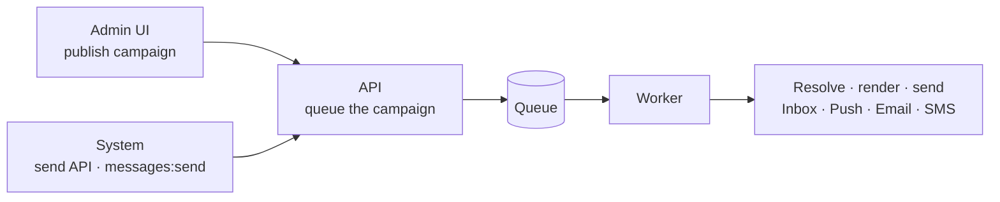
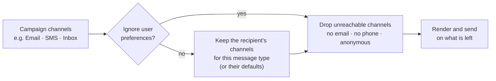
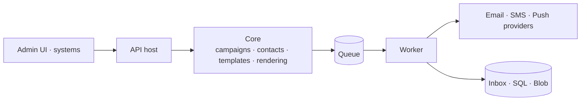
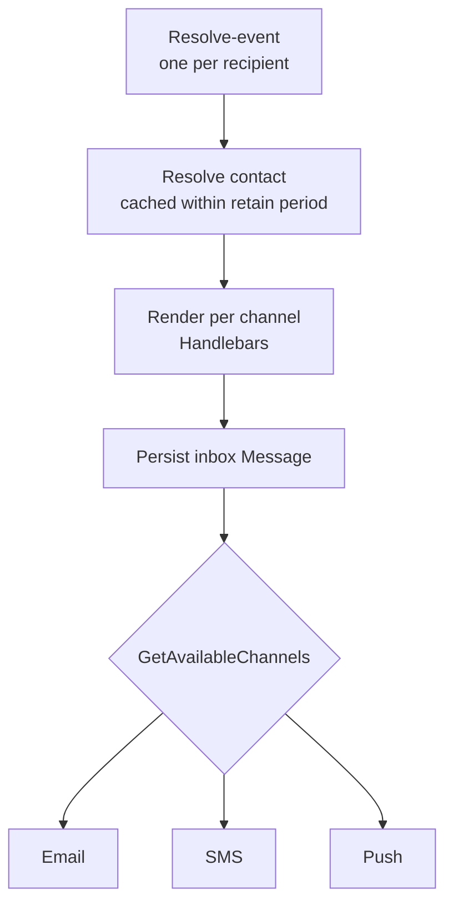

# 📨 Indice Messaging

*Owned, multichannel messaging & campaigns.*

A complete, campaign-based messaging product the client deploys on their own infrastructure. **Campaigns** are the
base unit: each one fans out to the right **channels** (Inbox, Push, Email, SMS) based on the campaign's settings and
each recipient's preferences and contact details. Marketing broadcasts and transactional messages (OTPs, receipts,
alerts) run through the same pipeline, with the same templates, audiences and analytics.

- **A deployed system, not a SaaS** — your databases, your queues, your delivery accounts, your operations.
- **Campaigns and transactional on one pipeline** — operators publish campaigns from the admin UI; other systems send
  through the send API; both are delivered the same way.

### 🌍 Where it fits

- **Broadcast & marketing** — newsletters, announcements, promotions to distribution lists or CSV-imported audiences.
- **Transactional & system** — OTPs, receipts, status alerts fired by other systems through the send API.
- **Employees & customers** — the same product serves internal workforce comms and external B2C / B2B audiences.
- **One campaign, many channels** — a single campaign targets Inbox, Push, Email and SMS, chosen per recipient.

| 📘 The product | 🛠️ For developers |
|---|---|
| 1. Core features & capabilities | 4. Architecture & hosting |
| 2. Flows | 5. Feature internals & integration |
| 3. Where Indice Messaging shines | 6. Configuration |

---

## 🧰 1. Core features & capabilities

### ⚡ Campaigns — the base unit

Everything you send is a campaign; a campaign carries its channels, content, audience and schedule.

- **`Campaign`** — the unit operators and systems create; turned into one `Message` per recipient.
- **Per-channel content** — title, body and optional sender per channel: rich HTML for email, short text for SMS.
- **Target channels** — which of Inbox, Push, Email and SMS this campaign may use.
- **Call to action** — an `ActionLink`, tracked for click analytics.
- **Scheduling & gating** — `ActivePeriod` window, `Published` gate, `IsGlobal` broadcast, `IgnoreUserPreferences` override.
- **Associations** — message `Type`, optional `Attachment`, and a `DistributionList` (the audience).

> A campaign is "this content, on these channels, to this audience, in this window" — turned into one rendered
> message per recipient per channel.

### 📡 Channels & delivery providers

One campaign, several channels; each channel goes through the vendor you choose.

- **Inbox** — in-app "My Messages", stored in your database; no external provider.
- **Push** — mobile push via Azure Notification Hubs → APNS (Apple) and FCM v1 (Android / Firebase).
- **Email** — SMTP, SendGrid, SparkPost, Brevo, Azure Communication Services.
- **SMS / Viber** — Yuboto, Yuboto Omni, Apifon, Twilio, Vonage, SmsUp, KapaTEL, Mstat (Viber via Yuboto Omni).
- **Your accounts** — the vendor per channel is a setting; switching vendors does not change campaigns, templates or audiences.

### 👥 Contacts, recipients & distribution lists

Audiences are first-class data — imported, retained, de-duplicated, and reusable across campaigns.

- **`Contact`** — a recipient keyed by `RecipientId` (your correlation code), with name, email and phone.
- **Distribution lists** — reusable audiences; each member can be marked `Unsubscribed`.
- **CSV import / export** — upload a CSV into a list, export a list back out.
- **Retained** — contacts persist across campaigns; a campaign without a list gets a *system-generated* distribution list.
- **Dedup & merge** — find duplicate contacts and merge them; lists, messages and events move to the surviving contact.

> Yesterday's recipients are tomorrow's audience — and who a campaign reached is always recoverable from its list.

### ✅ Preferences & consent

Delivery respects what each recipient chose and what they can actually receive — decided per campaign, per contact.

- **`ContactPreference`** — `Locale`, `ConsentCommercial` (+ date), `DefaultChannels`.
- **Per message type** — preferred channels per message type, so "email me offers, push me alerts" is expressible.
- **Reachability** — no email drops Email, no phone drops SMS, an anonymous contact drops Push and Inbox.
- **`IgnoreUserPreferences`** — bypasses preferences for genuine system messages; reachability still applies.
- **Self-service** — recipients read and update their own preferences through the inbox API.

> Preferences are applied when the campaign is sent, not when it is written: an operator picks "Email + SMS"; each
> recipient still only gets the channels they chose and can receive.

### 🧩 Templates & rendering

Reusable, composable content — authored per channel and rendered per recipient with Handlebars.

- **`Template`** — per-channel content, optional sample `Data` for preview, optional message type.
- **Three kinds** — Full (a complete message), Partial (a reusable fragment), Layout (a wrapper).
- **Personalised** — `{{contact.…}}`, `{{data.…}}`, campaign `title` / `actionLink` / `now` are available in every template.
- **Composition** — `{{> alias}}` fragments and layout wrappers are pulled from the templates store when a message is rendered.
- **Channel-aware encoding** — HTML-encoded for email and inbox, plain text for SMS.

Full guide: [Templates.md](./Templates.md).

### 🏷️ Message types & senders

- **`MessageType`** — a category (`Name`, `Alias`) with a `Classification`: System, Commercial, Info, Success, Error, Warning.
- **Preferences pivot on type** — recipients set their channel choices per message type.
- **`MessageSender`** — a configured "from" identity per channel (`Sender`, `DisplayName`, `IsDefault`).

### 📊 Analytics & tracking

Every meaningful action is recorded and rolled up into operator-facing KPIs.

- **Event types** — Created, Sent, Delivered, Read, UnRead, Opened, Deleted — per channel, with a success flag.
- **Click tracking** — CTA links go through a tracking URL that records a hit, then redirects to the `ActionLink`.
- **KPIs** — **Reached, Engaged, Acted, Coverage**, plus volume per channel and per message type.
- **Time series** — from the last 24 hours up to the last 12 months.

> Reached vs Engaged vs Acted: the dashboard separates "we sent it" from "they opened it" from "they clicked".

### 📥 Inbox & self-service

The in-app channel is a full surface of its own — read state, bulk actions, and preference management.

- **My messages** — a recipient lists their messages, opens one, marks it read or unread.
- **Bulk actions** — "mark all read" / "mark all unread".
- **Read state feeds analytics** — Read, UnRead, Opened and Deleted are all recorded events.
- **Preference self-service** — recipients manage their communication preferences through the same API.
- **Real time notifications** — inbox clients subscribe to a SignalR hub and get a personalized push for every new
  inbox message, instead of polling.
- **Inbox in the admin UI** — a notifications bell (unread count + preview of the latest unread messages, fetched only
  when the bell is opened) and a "My inbox" page (reachable from the bell and the user menu) with filters, built only on
  the user present `my/messages` API so other SPAs can do the same. The unread count uses `my/messages?isRead=false&size=0`
  (a page size of zero returns only the count).

### 🖼️ Media library & attachments

- **Attachments** — files attached to a campaign, delivered with email and inbox messages.
- **Media library** — folders and uploads managed from the admin UI.
- **Reusable in templates** — media links and images are available to templates.

### 🖥️ Management UI — Angular SPA

A full operator surface, compiled and served embedded from the API host.

- **Screens** — campaigns (create / edit builder), templates designer, distribution lists + CSV import, contacts,
  message types, media library, dashboard, events, settings.
- **Template designer** — a Handlebars code editor for per-channel content.
- **Personal inbox** — the signed-in operator's own messages: bell with unread count, preview dropdown and inbox page.
- **Dashboard** — charts over the analytics KPIs.

### 📤 Transactional send API & access

Other systems send messages through the same pipeline as operators — with their own, narrower permission.

- **Send API** — a system triggers a message with one request, under the `messages:send` scope.
- **Same pipeline** — a transactional send is delivered exactly like a campaign published from the UI.
- **Two scopes** — `messages` for operators (management), `messages:send` for machines (send only).
- **Campaign managers** — campaign authoring is limited to a role, not just a scope.
- **Optional multi-tenancy** — one deployment can isolate several tenants' data.

---

## 🔄 2. Flows

### 🔄 From request to delivery

Whether an operator publishes a campaign or another system calls the send API, the road is the same: the API accepts
the request and queues it; the worker delivers it.



The `Published` gate is the control point — a campaign can be created and scheduled, but nothing is sent until it is
published. A transactional message (e.g. an OTP) is a one-recipient, immediately-published campaign on this same
pipeline — with `IgnoreUserPreferences` for a true system message, and a fast `200 OK` with a `CreateCampaignResult` back to the caller.

### 🧭 Which channels a recipient gets

Each recipient's channels are worked out separately, when the campaign is sent.



One campaign can reach one recipient by email and SMS, another by inbox only, and skip a third who has neither an
email address nor a phone number — without the operator writing a rule for any of them.

---

## ⭐ 3. Where Indice Messaging shines

Two things set Indice Messaging apart. Multichannel delivery and recipient preferences are a single decision made
per recipient, not two features bolted together; and the delivery vendors are yours to choose and change without
touching campaigns, templates or audiences. The two pillars below expand each.

### 🧭 One campaign, every channel, preference-aware

- **One campaign, four channels** — Inbox, Push, Email and SMS on a single campaign, content authored per channel.
- **Per-recipient channels** — campaign channels, narrowed by the recipient's preference, minus what they can't receive.
- **Preferences per message type** — offers by email, alerts by push, chosen by the recipient.
- **Transactional override** — `IgnoreUserPreferences` separates "you opted in" from "you must receive this".
- **Reusable audiences** — distribution lists, CSV import and retained contacts feed every campaign.

### 🔌 Your vendors, your accounts

- **Swap providers by setting** — email, SMS / Viber and push vendors chosen in configuration.
- **Regional channels** — Viber and local Greek SMS gateways alongside the global providers.
- **No-op SMS** — `Sms:Provider = "none"` lets staging run the full send path without real SMS cost.
- **Your data stays home** — contacts, messages and analytics live in your database; consent and preferences come
  from your identity server.

### ✅ Capability summary

One grid to take to your team — the capability on the left, the mechanism that delivers it on the right.

| Capability | How it's delivered |
|---|---|
| One campaign → Inbox / Push / Email / SMS | ✅ `MessageChannelKind` flags |
| Preference-aware delivery | ✅ `GetAvailableChannels` per recipient |
| Transactional send API for other systems | ✅ `messages:send` endpoint |
| Handlebars templates | ✅ Full / Partial / Layout |
| CSV recipient import / export | ✅ distribution list import / export |
| Distribution lists + auto system lists | ✅ per campaign, retained |
| Contact dedup / merge | ✅ `MergeContacts` |
| Delivery + engagement analytics | ✅ Reached / Engaged / Acted / Coverage |
| CTA click tracking | ✅ tracked link + redirect |
| In-app inbox with read state | ✅ `MyMessages` API |
| Real time inbox notifications | ✅ SignalR proxy (`UseInboxSignalRNotifications`) |
| Media library + attachments | ✅ local / Azure Blob storage |
| Email / SMS / Viber / Push vendors | ✅ chosen by configuration |
| Scheduled + global (broadcast) campaigns | ✅ `ActivePeriod` + `IsGlobal` |
| Embedded Angular admin SPA | ✅ `UseMessagesUI` |
| Multi-tenancy | ✅ optional (`UseMultiTenancy`) |

---

# 🛠️ For developers

## 🏗️ 4. Architecture & hosting

- **Built on `Indice.Platform`** — `Indice.Features.Messages.{Core, AspNetCore, Worker, Worker.Azure, UI}`.
- **Standard foundations** — ASP.NET Core Minimal APIs, EF Core (SQL Server), Azure Storage / Service Bus, Handlebars.Net.
- **Reference templates** — `Indice.Messaging` (API + embedded admin UI) and `Indice.Messaging.Workers` (Azure Functions).

### 🏗️ 4.1 High-level architecture

Composable feature libraries; your host runs them; delivery happens off-thread through a queue and pluggable providers.



### 🏭 4.2 What's deployed in production

- **API host** — `MapMessaging()` + `UseMessagesUI()`, serving the endpoints and the embedded admin SPA.
- **Worker host** — Azure Functions (`Indice.Messaging.Workers`) *or* an in-process generic-host worker; both consume the same queues.
- **Event transport** — Azure Storage Queues (gzip-compressed envelopes) or Azure Service Bus.
- **Data** — SQL Server (`MessagesDb`, schema `cmp`), Blob storage for attachments and media.
- **Analytics batcher** — a hosted service drains an in-memory event queue into the analytics table off the hot path.
- **Retention cleanup** — a timer / cron job prunes old campaigns and inbox messages on your schedule.

> Two hosts, one queue: the API stays responsive because it only enqueues; delivery, rendering and analytics all
> happen in the worker.

### 🔧 4.3 Composition + reference templates

```csharp
// API host (Indice.Messaging/Program.cs)
builder.Services.AddMessaging(options => {
    options.ConfigureDbContext = (sp, db) => db.UseSqlServer(cfg.GetConnectionString("MessagesDb"));
    options.RequiredScope = cfg.GetApiResourceName();   // "messages"
    options.PathPrefix    = "/api";
    options.UseFilesAzure();                            // Blob attachments/media
    options.UseEventDispatcherAzure();                  // Azure Storage Queue transport
    options.UseIdentityContactResolver(o => { /* pull contact data + prefs from Identity */ });
});
app.UseMessagesUI(o => { o.EnableMediaLibrary = true; });
app.MapMessaging();

// Worker host (Indice.Messaging.Workers/Program.cs)
builder.AddMessageFunctions(options => {
    options.UseEventDispatcherAzure()
           .UseFilesAzure()                             // same storage backend as the API host
           .UsePushNotificationServiceAzure()
           .UseEmailService(cfg).UseSmsService(cfg)     // providers picked by config
           .UseIdentityContactResolver(/* … */);
    options.DatabaseCleanUpOptions.Enabled = true;      // retention: 180d inbox / 120d other
});
```

---

## 🧩 5. Feature internals & integration

### 🔄 Resolve & fan-out in the worker

The worker resolves each recipient, renders per channel, writes the inbox copy, then emits one send-event per
allowed channel.



- **Zero to three send-events** — external channels are emitted only if `GetAvailableChannels` allows them.
- **Thin send handlers** — call the provider, record the outcome off-thread; the send itself never blocks.
- **Scheduling is the queue** — far-future campaigns ride the visibility timeout and are re-enqueued in windows.

### 📡 Channels

- **`[Flags]` enum** — `MessageChannelKind`: Inbox `1`, PushNotification `2`, Email `4`, SMS `8`; `Email | SMS | Inbox` is one value.
- **Keyed DI** — each channel resolves to an injected service (`IEmailService`, `ISmsService`, `IPushNotificationService`)
  or the inbox store.

### 📊 Analytics

- **Async capture** — actions enqueue an event; the analytics hosted service batches them into `MessageEvent` records.
- **Click tracking** — links are rewritten to `/_tracking/…`; `TrackingHandlers` records a `Hit`, then 302-redirects.
- **Roll-ups** — `OverviewMetrics`, `RecipientMetrics` and `MessageEventSeries`; `analytics/*` endpoints are output-cached.

### 📥 Inbox

- **`MyMessagesApi`** — list, get, mark read / unread, preferences.
- **Bulk actions on queues** — `my-messages-mark-all-read` / `my-messages-mark-all-unread`.
- **Notifications** — `IInboxNotifier` is called whenever an inbox message is created (per recipient by the resolve
  handler, once for everybody for global campaigns). The default is a no-op; `UseInboxSignalRNotifications()` pushes
  through the SignalR proxy. Only messages within their active period are pushed and a failed push never fails delivery.

#### 🔔 Real time inbox notifications (SignalR)

The integrator hosts the SignalR service (e.g. Azure SignalR); the API only proxies the negotiation through the
SignalR proxy feature of `Indice.AspNetCore`, so clients connect with their usual access token.

```csharp
// API host: negotiate endpoints for the inbox clients
builder.AddSignalRProxy();                       // reads the "SignalRProxy" section & ConnectionStrings:SignalR
app.MapSignalRProxy();                           // POST /hubs/{hubName}/negotiate …

// Whoever creates the inbox messages: the worker (AddMessageFunctions / AddMessageJobs),
// or the API host when it processes the events in-process (AddMessaging)
builder.AddMessageFunctions(options => {
    options.UseInboxSignalRNotifications(o => {
        o.HubName = "messaging";                 // must be in SignalRProxy:AllowedHubs
        o.MethodName = "inboxMessageCreated";    // client method invoked with an InboxMessageNotification
        o.NotifyGlobalMessages = true;           // push global (broadcast) campaigns to everybody
    });
});
```

```json
{
  "ConnectionStrings": { "SignalR": "Endpoint=https://…;AccessKey=…;Version=1.0;" },
  "SignalRProxy": { "AllowedHubs": [ "messaging" ] }
}
```

- **Addressing** — notifications go to the contact's `RecipientId`, the user id the proxy resolves from the `sub`
  claim; register a custom `ISignalRProxyUserIdResolver` if recipients are identified by another claim.
- **Client** — `@microsoft/signalr` with `withUrl('{api}/hubs/messaging', { accessTokenFactory })` and
  `connection.on('inboxMessageCreated', notification => …)`; the payload carries `id`, `title`, `type`,
  `activePeriod`, `isGlobal` and `createdAt`.
- **Admin UI** — set `CampaignUIOptions.InboxHubUrl = "/hubs/messaging"` (relative urls resolve against the API
  origin; use an absolute url when the hub lives elsewhere) for the bell to update live; without it the UI refreshes the unread count rarely (every 5 minutes and
  whenever the browser tab becomes visible again).

### 🖼️ Media library

- **Own context** — `MediaDbContext`, in the same `MessagesDb` as the campaigns.
- **Storage** — `IFileService`: `UseFilesLocal()` for dev, `UseFilesAzure()` for production.
- **Wiring** — `AddMediaLibrary()` / `MapMediaLibrary()`, shown in the admin UI with `EnableMediaLibrary = true`.

### 🖥️ Management UI

- **Served in-process** — `UseMessagesUI()` streams the packaged Angular bundle; no separate deployment.
- **Sign-in** — OIDC client `messaging-ui` through your identity server; NSwag-generated API clients.

### 🔐 Authorization

- **Policies** — `BeCampaignManager` (role or admin) and `HaveMessagesScope` guard the management endpoints.
- **Contacts** — `ContactsCsvUtility` handles import / export; `GetDuplicates` / `MergeContacts` handle dedup.

---

## ⚙️ 6. Configuration

Everything that can be a setting is a setting. Code is for the seams — providers, resolvers, custom handlers.

| Section | What it controls |
|---|---|
| `ConnectionStrings` | `MessagesDb` (SQL), `StorageConnection` (queues + blob), `PushNotificationsConnection` |
| `General:Authority` / `General:Api` | identity server, `messages` resource, `messages:send` scope, introspection secret, worker `ClientId` / `ClientSecret` |
| `Email` / `Sms` / `PushNotifications` | delivery providers and their parameters |
| Event dispatcher | Azure Storage Queue, Azure Service Bus, or in-process |
| Worker options | polling / triggers, schema, contact retain period |
| `Analytics` | enable + batching |
| Database cleanup | retention (inbox vs other), cron |
| Multi-tenancy / auth | scopes, access level, policies |

### 🔌 Channel providers

Per-channel provider selection and credentials. The pipeline calls an abstraction; config decides the implementation.

```jsonc
"Email": {
  "Provider": "SparkPost",   // Smtp · SendGrid · SparkPost · Brevo · AzureCommunicationServices
  "Sender": "no-reply@your-domain.gr",
  "SmtpHost": "…", "SmtpPort": 587, "UseSSL": true
},
"Sms": {
  "Provider": "yuboto",      // yuboto · yuboto_omni · yuboto_viber · apifon · apifon_im · twilio · vonage · smsup · kapatel · mstat · none
  "ApiKey": "…", "Sender": "MyBrand"
},
"PushNotifications": { "ConnectionString": "…", "NotificationHubPath": "…" }
```

- **Swap vendors by config** — moving from SparkPost to SendGrid is one line, no code change.
- **No-op SMS** — set `Sms:Provider` to `"none"` so staging exercises the full send path without real SMS cost.
  `TestMode` is not a provider-independent safeguard (Yuboto Omni ignores it and sends real requests).

### 🔀 Event dispatch & workers

The transport between the API host and the worker, and the worker's own trigger model.

```jsonc
// API host — choose the dispatcher
// options.UseEventDispatcherAzure();            // Azure Storage Queues (gzip envelopes)
// options.UseEventDispatcherAzureServiceBus();  // Azure Service Bus

// Worker (Azure Functions) — host.json queue tuning
"extensions": {
  "queues": { "batchSize": 16, "maxDequeueCount": 5, "visibilityTimeout": "00:00:30" }
}
```

- **Two transports, one code path** — Storage Queues for simplicity, Service Bus for higher scale / ordering needs.
- **Two worker models** — Azure Functions (serverless) or an in-process hosted worker; same handlers.

### 🔗 Contact resolution & retention

Where contact data and preferences come from, and how long a resolved contact is trusted before re-fetching.

```csharp
options.UseIdentityContactResolver(o => {
    o.BaseAddress  = new Uri(authority);
    o.ClientId     = "…"; o.ClientSecret = "…";
    o.ClaimsToResolve = [ ConsentCommercial, ConsentCommercialDate, Locale, CommunicationPreferences ];
});
// Re-resolve a contact from source only after the retain period
// MessageWorkerOptions.ContactRetainPeriodInDays = 30;
```

- **Single source of truth** — consent, locale and preferences come from your identity server, not a copy.
- **Retain period** balances freshness against load.

### 📊 Analytics

```jsonc
"Analytics": { "Enabled": true }
```

```csharp
// The "Analytics" section is not bound automatically — bind it explicitly in each host
builder.Services.AddMessaging(options => {
    cfg.GetSection("Analytics").Bind(options.AnalyticsOptions);
});
builder.AddMessageFunctions(options => {
    cfg.GetSection("Analytics").Bind(options.CampaignStatisticOptions);
});
```

```jsonc
// Batching handled by the analytics hosted service (default ~10 events / 1s)
// analytics/* endpoints are output-cached (~10 min)
```

- **Off the hot path** — capture is a bounded in-memory queue; a send never waits on an analytics write.
- **Fully optional** — turn analytics off where you don't need it.

### 🧹 Database cleanup & retention

```csharp
options.DatabaseCleanUpOptions.Enabled = true;
options.DatabaseCleanUpOptions.RetentionDaysForInbox = 180;  // campaigns with an inbox copy
options.DatabaseCleanUpOptions.RetentionDaysForOther = 120;  // everything else
// runs on a timer/cron trigger (MessagingDatabaseCleanUp)
```

- **Inbox lives longer than transport** — users revisit inbox messages; a delivered SMS record needn't linger as long.
- **Bounded growth** — retention keeps `MessagesDb` from growing without limit.

### 🔐 Multi-tenancy & authorization

```csharp
options.RequiredScope = "messages";     // management API scope
// SendScope           = "messages:send" // transactional send scope
// options.UseMultiTenancy(accessLevel); // isolate data across tenants
// Policies: BeCampaignManager · HaveMessagesScope
```

### 🔐 Identity provisioning

- **API resource** `messages` with the claims `admin`, `email`, `given_name`, `family_name`, `name`, `phone_number`, `role`, `sub`;
  plus the `messages:send` scope for systems that only send.
- **API resource** `media` for the media library, with the same claims.
- **Client** `messaging-ui` (authorization code) for the admin SPA; API resources `identity`, `messages`, `media`;
  identity resources `openid`, `profile`, `email`, `role`, `offline_access`.
- **Worker client** — a client-credentials client (`General:Api:Secrets:ClientId` / `ClientSecret`, `messages-worker`
  in the template) used by the contact resolver.

### 🗄️ Databases & migrations

- **Two contexts, one database** — `CampaignsDbContext` and `MediaDbContext` in `MessagesDb`, each with its own
  migrations history table.
- **Your migrations assembly** — the template's `README.md` shows the `MigrationsAssembly` / `MigrationsHistoryTable`
  setup and the `dotnet ef migrations add --context …` commands.

### 🧰 Extensibility

The C# seams where your code plugs into the pipeline without forking anything.

```text
IContactResolver              your own source of truth for contacts + preferences
ICampaignJobHandler<TEvent>   react to pipeline events / add processing steps
Use* provider builders        swap Email / SMS / Push implementations by config
IFileService                  your own storage for attachments and media
Template (Partial / Layout)   compose content from reusable fragments at render time
UseMessagesUI overrides       theme and configure the embedded admin SPA
```

- **C# interfaces, not a DSL** — the team that writes ASP.NET Core writes the extensions.
- **In-process** — extensions run in your host, debuggable with the rest of your app.
- **Event-driven** — new behaviour slots in as a handler on an existing event.
