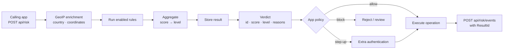
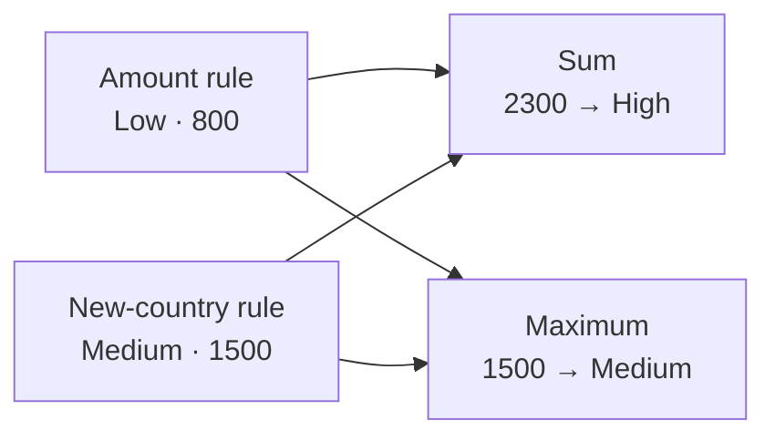
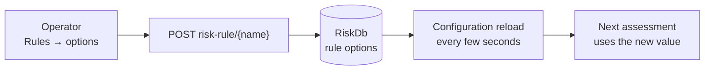
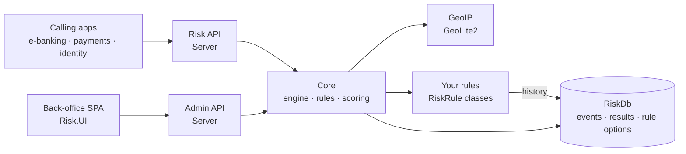
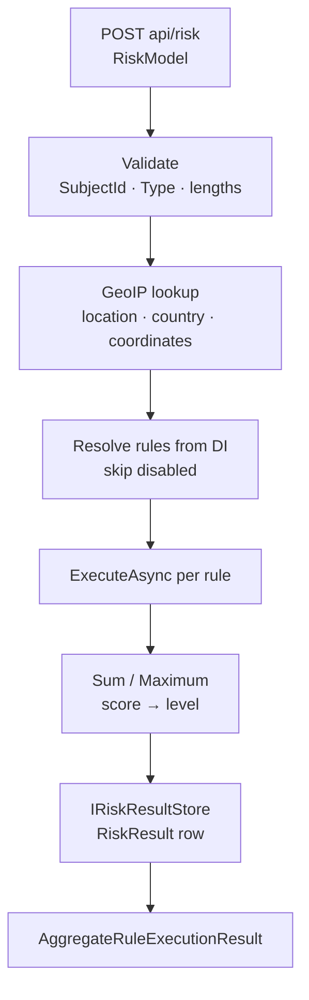

# 🛡️ Indice Risk

*Owned, configurable risk assessment for transactions & customer activity.*

A complete risk assessment engine the client deploys on their own infrastructure. **Risk rules** are the base unit:
each one is a C# class that looks at an operation, and its thresholds are settings that operators change at runtime.
Before an application commits a transfer, a payment, a login or a profile change, it sends the operation to the
engine. The engine adds the location of the caller's IP address, runs every enabled rule and combines the results
into one **risk score** and one **risk level** (`None` · `Low` · `Medium` · `High`). The application then lets the
operation through, asks for step-up authentication, or blocks it.

- **A deployed system, not a SaaS** — your database, your rules, your thresholds, your operations.
- **One engine for every application** — antifraud logic leaves the individual business workflows; web banking,
  mobile, payments and identity flows all call the same API and follow the same policy.

### 🌍 Where it fits

- **Payments & transfers** — assess the amount, destination and frequency before execution.
- **Authentication & sessions** — flag logins from new countries or impossible locations, then require step-up authentication (MFA).
- **Account changes** — profile, device or beneficiary changes followed by an unusual operation.
- **Session-level analysis** — group the events of one session and review them together.
- **Fraud operations** — investigators search assessments and events and see why each one scored the way it did.

| 📘 The product | 🛠️ For developers |
|---|---|
| 1. Core features & capabilities | 4. Architecture & hosting |
| 2. Flows | 5. Feature internals & integration |
| 3. Where Indice Risk shines | 6. Configuration |

---

## 🧰 1. Core features & capabilities

### ⚡ Risk rules — the base unit

A rule is one piece of fraud policy: it looks at an operation and returns a risk level, a score and a reason.

- **`RiskRule`** — a unique `Name` (also the rule id) and an `ExecuteAsync` method that receives the enriched event.
- **Full access to your services** — rules come from dependency injection, so a rule can query the subject's history,
  call your own systems or use anything else in the container.
- **Typed verdicts** — `NoRisk()`, `LowRisk(…)`, `MediumRisk(…)`, `HighRisk(…)`, each with an optional exact score and
  a reason, for example `HighRisk(3000, "The URL … is a known suspicious URL.")`.
- **One registration call** — `AddRule<TRule, TOptions, TValidator>(name)`; a new requirement is a new rule class in the
  host, not a change to the engine.
- **Sample included** — the template's `DummyModelRiskRule` flags suspicious URLs and texts in the operation's data.

> The engine encodes no fraud policy of its own. It runs your rules, combines their results and records what happened.

### ⚙️ Rule options — thresholds as data

Every rule has a typed options class, and its values are stored settings rather than constants in code.

- **`RuleOptions`** — `FriendlyName`, `Description`, `Enabled` and `EligibleEvents` (the event names the rule is meant
  for, kept with its options so the rule can check them).
- **Your own fields** — amount limits, allowed countries, block lists, time windows: whatever the rule needs.
- **Stored in `RiskDb`** — options live in the database, not in `appsettings.json`.
- **Changed at runtime** — operators edit them from the back-office UI; new assessments pick up the change within
  seconds, without a redeploy.
- **Switch rules on and off** — `Enabled` takes a noisy rule out of scoring without touching code.

### 🎯 Risk assessment — `POST api/risk`

One call evaluates one operation in real time and returns the verdict.

- **Input** — who (`SubjectId`), what kind of operation (`Type`, `Name`), `Amount`, `IpAddress`, `SessionId`, which system
  (`SourceId`) and its transaction id (`SourceTransId`), plus `Data`: any JSON payload your rules understand.
- **Enriched** — before any rule runs, the IP address is resolved to a location, a country and coordinates.
- **Every enabled rule runs** — disabled rules are skipped.
- **Verdict** — a result id, the number of rules executed, the overall score and level, and each rule's level, score and reason.
- **Kept** — every assessment is stored with its input and per-rule breakdown, whether or not the operation goes ahead.
- **Validated** — `SubjectId` and `Type` are required, and field lengths are checked.

### 🧮 Scoring & risk levels

Rule results become one score and one level; both steps are configuration.

- **Level ranges** — each level gets a score range. The default is None 0–1 · Low 2–333 · Medium 334–666 · High 667–1000;
  the template uses 0 · 1–1000 · 1001–2000 · 2001–3000.
- **Aggregation** — `Sum` (risk accumulates across rules) or `Maximum` (the worst single rule decides).
- **Consistent scores** — a rule's explicit score must fall in its level's range; without one, the score is the top of that range.
- **Your response policy** — the calling application maps levels to actions, for example `None` / `Low` → allow,
  `Medium` → step-up authentication, `High` → block or review.

> The engine says how risky an operation is; the institution decides what that means for the customer.

### 🗂️ Events & history — `POST api/risk/events`

An assessment answers "how risky is this?"; an event records "this happened". Recorded events are the history rules work with.

- **Recorded after the fact** — applications usually record the event once the operation completes.
- **Linked to the verdict** — send the assessment's `ResultId` with the event, and each completed operation keeps the
  assessment it was given.
- **Enriched** — stored events carry location, country and coordinates, plus session, source system, transaction id and data.
- **Queried by rules** — a subject's past events by name, time window and arbitrary filters. This is how rules check
  velocity, frequency, new-country or "first time to this beneficiary" conditions.

### 🌍 Geolocation

- **Local, offline lookup** — MaxMind GeoLite2 City / Country / ASN databases ship with the product; no external service.
- **Rule input** — rules see the country and coordinates, so they can check for an unexpected country, distance from
  the last login or impossible travel.
- **Searchable** — back-office users filter events by country and location.

### 🔎 Investigation & administration — the admin API

The endpoints the back-office SPA uses, also available to your own tools.

| Endpoint | What it does |
|---|---|
| `GET risk-results` | paged, sortable assessments; filter by date range, id, subject, name, type, IP |
| `GET risk-events` | paged, sortable events; filter by date range, id, subject, name, type, IP, session, country, location, source transaction |
| `GET risk-events/session/{sessionId}` | every event of one session |
| `GET risk-rules` | the registered rules, with display name, description and enabled state |
| `GET risk-rule/{ruleName}` | the stored options of one rule |
| `POST risk-rule/{ruleName}` | save one rule's options |

- **Filter clauses** — `eq`, `neq` and `contains` on each supported field, plus `from` / `to` date bounds.

### 🖥️ Back-office UI — Angular SPA

An operator console, compiled into `Risk.UI` and served embedded from the API host.

- **Risk results** — every assessment with its time, level, score, event, subject, amount, number of rules and IP.
  The detail pane shows the verdict, each rule's score, level and reason, the evaluated data and a link to the recorded event.
- **Risk events** — every recorded event, filterable by subject, name, type, IP, country, location, session and source
  transaction; the detail pane lists every field, geolocation included.
- **Rules** — the registered rules and their state. The options form is generated from the stored options: toggles for
  flags, text for values, eligible events as a comma-separated list.
- **Themes** — light, dark and system.

### 🔐 Access

- **OAuth2-protected** — every endpoint requires a bearer token with the `risk` scope, or a system client.
- **Machine to machine** — calling applications use client-credentials clients.
- **Operators** — sign in to the SPA through your identity server.

---

## 🔄 2. Flows

### 🔄 Assess, act, record

The typical integration: one call before the operation, the institution's own decision, one call after.



The assessment is stored whether or not the operation goes ahead. The event is recorded only for what actually
happened, and the `ResultId` links the two. Every later assessment for the same subject can use the recorded events as history.

### 🧮 Example: one assessment, two strategies

With the template's ranges (Low 1–1000, Medium 1001–2000, High 2001–3000), suppose two rules fire on a transfer:



Under `Sum`, two moderate signals together reach `High`. Under `Maximum`, only the strongest single signal counts.
The choice is configuration, and so is the score range of each level.

### ⚙️ Changing a threshold without a redeploy



An operator raises an amount limit, adds a destination to a block list or disables a noisy rule. The change is saved
to `RiskDb`, and within the reload interval every new assessment runs with it.

---

## ⭐ 3. Where Indice Risk shines

Two things set Indice Risk apart. Fraud policy is split between code that defines *what* to check and data that
defines *how strict* to be, so each changes at its own pace; and every verdict can be explained, rule by rule, long
after it was given. The two pillars below expand each.

### 🧭 Policy as code + data

A new fraud pattern is a new rule; a tighter limit is a setting.

- **Rules in code** — detection logic is reviewed, versioned, unit-tested and debugged like the rest of your software.
- **Thresholds as data** — operators change limits, lists and switches from the UI; no redeploy.
- **Scoring as configuration** — level ranges and the aggregation strategy are set once in the host.
- **History built in** — recorded events give every rule the subject's past activity.
- **One policy, every channel** — all applications call the same engine with the same rules.

### 🔍 Explainable, auditable decisions

- **Every assessment stored** — input, score, level and each rule's contribution.
- **Reasons, not just numbers** — each rule says why it scored the way it did.
- **Verdict linked to outcome** — a recorded event points back to the assessment it was given.
- **Investigation console** — filter by subject, session, IP, country or transaction and drill into any decision.
- **Your data stays home** — events, assessments and rule settings live in your SQL Server; GeoIP lookups never leave the host.

### ✅ Capability summary

One grid to take to your team — the capability on the left, the mechanism that delivers it on the right.

| Capability | How it's delivered |
|---|---|
| Real-time risk assessment | ✅ `POST api/risk` |
| Custom rules in C# | ✅ `RiskRule` + `AddRule<…>` |
| Runtime-editable rule thresholds | ✅ `RuleOptions` in `RiskDb`, hot-reloaded |
| Typed, per-rule options | ✅ `RuleOptions` subclass per rule |
| Enable / disable rules without a redeploy | ✅ `Enabled` option, rules toggle in the UI |
| Configurable risk levels | ✅ `RiskLevelRangeMapping`, overlap-checked |
| Configurable aggregation | ✅ `Sum` / `Maximum` |
| Per-rule reasons and scores | ✅ `AggregateRuleExecutionResult.Results` |
| Historical activity for rules | ✅ `IRiskEventStore.GetList(subject, names, dates, filters)` |
| IP geolocation enrichment | ✅ bundled GeoLite2, country + coordinates stored |
| Session-level view | ✅ `SessionId`, `risk-events/session/{id}` |
| Verdict ↔ operation link | ✅ `ResultId` on the recorded event |
| Searchable events and results | ✅ admin API filter clauses + SPA |
| Embedded back-office SPA | ✅ `UseRisksUI` |
| OAuth2-protected APIs | ✅ `risk` scope or system client |
| Step-through debugging of a verdict | ✅ rules run in your own process |

---

# 🛠️ For developers

## 🏗️ 4. Architecture & hosting

- **Built on `Indice.Platform`** — `Indice.Features.Risk.{Core, Server, UI}`; the SPA source is `Indice.Features.Risk.App`.
- **Standard foundations** — ASP.NET Core Minimal APIs, EF Core (SQL Server + NetTopologySuite), FluentValidation,
  MaxMind GeoLite2 (through `Indice.Features.GeoIP`).
- **Reference template** — `Indice.Risk`: one host serving the API and the embedded back-office SPA, with a sample rule.

### 🏗️ 4.1 High-level architecture

Composable feature libraries in one host. Calling applications use the risk API; operators use the admin API through the SPA.



- **Core** — `RiskService` (runs the rules and aggregates), `RiskStoreService` (events and results), `AdminRuleService`
  (rule catalogue and options), the `RiskRule` / `RuleOptions` / `RuleOptionsValidator` base types, `RiskDbContext` and the EF Core stores.
- **Server** — Minimal API endpoints for calling apps (`MapRisk`) and for administration (`MapAdminRisk<TOptions>`), plus request validation.
- **UI** — the packaged Angular SPA, served embedded from the API host (`UseRisksUI`).

### 🏭 4.2 What's deployed in production

- **One host** — risk API, admin API and back-office SPA in a single ASP.NET Core app.
- **One database** — `RiskDb` on SQL Server: `RiskEvent` and `RiskResult` hold the history, `AppSetting` holds every rule's options.
- **Spatial support** — event coordinates are stored as geography points (SRID 4326) through NetTopologySuite.
- **Bundled GeoIP data** — the GeoLite2 databases ship inside `Indice.Features.GeoIP`.
- **Database-backed configuration** — rule options are read through the database configuration provider and reloaded
  on an interval (5 seconds in the template).
- **Distributed cache** — memory by default, Redis when `ConnectionStrings:Redis` is set.

> One deployable, one store: every assessment, every recorded event and every rule setting is a row in the client's own SQL Server.

### 🔧 4.3 Composition + reference template

```csharp
// Indice.Risk/Extensions/RiskConfigurationExtensions.cs
builder.WebHost.AddDatabaseSettings<RiskDbContext>((options, configuration) => {
    options.ReloadOnInterval = TimeSpan.FromSeconds(5);      // rule options hot-reload from RiskDb
    options.ConfigureDbContext = db => db.UseSqlServer(cs, sql => sql.UseNetTopologySuite());
});

builder.Services.AddRiskEngine(options => {
    options.RiskLevelRangeMapping = new RiskLevelRangeDictionary(new Dictionary<RiskLevel, IntegerRange> {
        [RiskLevel.None]   = new IntegerRange(0, 0),
        [RiskLevel.Low]    = new IntegerRange(1, 1000),
        [RiskLevel.Medium] = new IntegerRange(1001, 2000),
        [RiskLevel.High]   = new IntegerRange(2001, 3000)
    });
    options.RiskAggregateScoreResolution = RiskAggregateScoreResolutionType.Sum;
})
.AddRule<DummyModelRiskRule, DummyModelRiskRuleOptions, DummyModelRiskRuleOptionsValidator>(nameof(DummyModelRiskRule))
.AddEntityFrameworkCoreStore(db => db.UseSqlServer(cs, sql => sql.UseNetTopologySuite()));

// Indice.Risk/Program.cs
app.UseRisksUI();                          // embedded back-office SPA
app.MapRisk();                             // POST api/risk, POST api/risk/events
app.MapAdminRisk<DummyRuleOptions>();      // events, results, rules, rule options
```

---

## 🧩 5. Feature internals & integration

### 🎯 The assessment pipeline



- **Rules are transient services** — resolved per assessment, so they can take scoped services such as `IOptionsSnapshot`
  and the stores.
- **The engine runs every enabled rule** — it does not filter by `EligibleEvents`; a rule that applies only to some
  events checks the event name itself.
- **Per-rule breakdown** — `Results` carries each rule's name, level, score and reason, and is stored with the result.

### ⚙️ Rule options storage

- **Flattened keys** — each option is an `AppSetting` row keyed `RuleOptions:{rule}:{field}`.
- **Bound per rule** — `AddRule` binds the options class to `RuleOptions:{name}`; a rule reads them through `IOptionsSnapshot`.
- **Hot reload** — `AddDatabaseSettings<RiskDbContext>` reloads the configuration on `ReloadOnInterval`.
- **Polymorphic over HTTP** — the admin endpoints read and write options as the host's base options type, with a
  discriminator that selects each rule's concrete class.
- **Duplicate names fail at startup** — two rules registered under the same name stop the host.

### 🧮 Scoring

- **`RiskLevelRangeDictionary`** — overlapping ranges throw at startup; a score above the `High` range counts as `High`.
- **Default scores** — a verdict without an explicit score takes the upper limit of its level's range, so rules agree on scale.

### 🗂️ Event & result stores

- **`IRiskEventStore.GetList(subjectId, names, startDate, endDate, filters)`** — the history query rules use.
- **Indexes** — `RiskEvent` by `SubjectId`, plus a filtered index on `SessionId`.
- **No store, still scoring** — without `AddEntityFrameworkCoreStore`, events go to a no-op store and the engine still scores.

### 🖥️ Back-office UI

- **Served in-process** — `UseRisksUI()` streams the packaged bundle; OIDC client `risk-ui`, scopes `openid profile role email risk`.
- **Stack** — Angular, Tailwind 4 + daisyUI 5, light / dark / system themes.

### 🔐 Authorization

- **One policy** — the risk API and the admin API both require the `risk` scope or a system client.
- **`RiskApiOptions`** — `ApiPrefix`, `ApiScope` and `AuthenticationScheme`, set through `AddRiskEndpoints`.

---

## ⚙️ 6. Configuration

Everything that can be a setting is a setting. Code is for the seams: rules, stores, scoring.

| Section | What it controls |
|---|---|
| `ConnectionStrings` | `RiskDb` (SQL Server with NetTopologySuite), optional `Redis` |
| `General:Authority` / `General:Api` | identity server, the `risk` API resource and its introspection secret |
| `RiskEngineOptions` | level ranges (`RiskLevelRangeMapping`) and aggregation (`Sum` / `Maximum`) |
| `RuleOptions:{rule}` | each rule's options, stored in `RiskDb` and editable at runtime |
| `RiskApiOptions` | API prefix, required scope, authentication scheme |
| `RisksUIOptions` | API URL, language, OIDC client and scope of the SPA |

### 🧮 Engine

```csharp
builder.Services.AddRiskEngine(options => {
    options.RiskLevelRangeMapping = new RiskLevelRangeDictionary(new Dictionary<RiskLevel, IntegerRange> {
        [RiskLevel.None]   = new IntegerRange(0, 0),
        [RiskLevel.Low]    = new IntegerRange(1, 1000),
        [RiskLevel.Medium] = new IntegerRange(1001, 2000),
        [RiskLevel.High]   = new IntegerRange(2001, 3000)
    });
    options.RiskAggregateScoreResolution = RiskAggregateScoreResolutionType.Maximum;
})
.AddRule<LargeTransferRule, LargeTransferRuleOptions, LargeTransferRuleOptionsValidator>("LargeTransfer")
.AddRule<NewCountryRule, NewCountryRuleOptions, NewCountryRuleOptionsValidator>("NewCountry")
.AddEntityFrameworkCoreStore(db => db.UseSqlServer(cs, sql => sql.UseNetTopologySuite()));
```

- **Scale to fit your policy** — a wide scale such as 0–3000 leaves room for many rules to accumulate under `Sum`.
- **Checked at startup** — overlapping ranges and duplicate rule names stop the host from starting.

### ✍️ Writing a rule

```csharp
public class LargeTransferRule : RiskRule
{
    private readonly LargeTransferRuleOptions _options;
    private readonly IRiskEventStore _events;

    public LargeTransferRule(IOptionsSnapshot<LargeTransferRuleOptions> options, IRiskEventStore events)
        : base("LargeTransfer") {
        _options = options.Value;
        _events = events;
        Options = _options;   // without this the rule keeps the default Enabled = false and is skipped
    }

    public override async ValueTask<RuleExecutionResult> ExecuteAsync(DbRiskEvent @event) {
        var o = _options;
        if (@event.Amount < o.Threshold) return RuleExecutionResult.NoRisk();
        var recent = await _events.GetList(@event.SubjectId, ["Transfer"], DateTime.UtcNow.AddHours(-24));
        return recent.Count() >= o.MaxPerDay
            ? RuleExecutionResult.HighRisk($"{recent.Count()} large transfers in 24h.")
            : RuleExecutionResult.MediumRisk($"Transfer above {o.Threshold}.");
    }
}

public class LargeTransferRuleOptions : MyRuleOptions { public decimal Threshold { get; set; } public int MaxPerDay { get; set; } }

public class LargeTransferRuleOptionsValidator : RuleOptionsValidator<LargeTransferRuleOptions> {
    public LargeTransferRuleOptionsValidator() { RuleFor(x => x.Threshold).GreaterThan(0); }
}
```

- **Three classes per rule** — the rule, its options and its validator; the base validator requires `FriendlyName` and `Description`.
- **Seed or edit** — initial options can be seeded into `AppSetting` (see `Seed/DummyRiskRuleSeed.cs`) or entered from the UI.

### 🔀 Polymorphic options for the admin API

```csharp
public class MyRuleOptions : RuleOptions { internal const string TypeDiscriminator = "name"; }

builder.Services.ConfigureHttpJsonOptions(o =>
    o.SerializerOptions.Converters.Add(new JsonPolymorphicConverterFactory<MyRuleOptions>(MyRuleOptions.TypeDiscriminator)));

app.MapAdminRisk<MyRuleOptions>();
```

- **One base type per host** — every options class derives from it, and the admin endpoints deserialize each rule's
  options to its concrete type.

### 🔌 API & UI

```csharp
builder.Services.AddRiskEndpoints(o => {
    o.ApiPrefix = "/api";                // default
    o.ApiScope = "risk";                 // default
    o.AuthenticationScheme = "Bearer";   // default
});
app.UseRisksUI(o => { o.ApiUrl = "…"; o.Lang = "en"; });
```

- **Defaults work** — the template doesn't call `AddRiskEndpoints` and calls `UseRisksUI()` without options.

### 🔐 Identity provisioning

- **API resource** `risk`, with an introspection secret (`General:Api:Secrets:Introspection`).
- **Client** `risk-ui` (authorization code + PKCE) for the back-office SPA, with scopes `openid profile role email risk`.
- **Client** `swagger-ui` for the API documentation at `/docs`.
- **Calling applications** — client-credentials clients with the `risk` scope.

### 🗄️ Database & migrations

- **One context** — `RiskDbContext` with `RiskEvent`, `RiskResult` and `AppSetting`.
- **Spatial types** — enable `UseNetTopologySuite()` on the SQL Server provider, for both the context and the settings provider.
- **Template bootstrap** — the template creates the schema on first run and seeds the sample rule's options; a
  production host uses its own migrations.

### 🧰 Extensibility

The C# seams where your code plugs into the engine without forking anything.

```text
RiskRule                       your fraud logic (AddRule<TRule, TOptions, TValidator>)
RuleOptions                    your thresholds, lists and limits, editable at runtime
RuleOptionsValidator<T>        your validation of those options (FluentValidation)
IRiskEventStore                history queries inside rules, or your own event store
IRiskResultStore               your own result persistence
IRuleOptionsStore              your own rule-options storage
RiskEngineOptions              level ranges and aggregation strategy
RisksUIOptions                 API URL and language of the SPA
```

- **C# classes, not a DSL** — the team that writes ASP.NET Core writes the rules.
- **In-process** — rules run in your host, debuggable with breakpoints and unit-testable as ordinary classes.
- **Safe defaults** — without a store registered, events go to a no-op store and the engine still scores.
