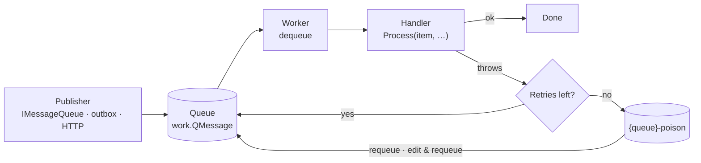
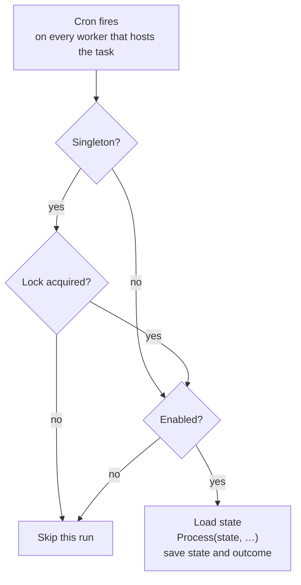
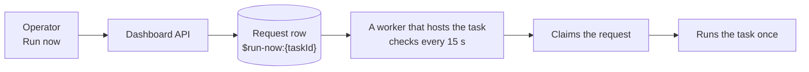
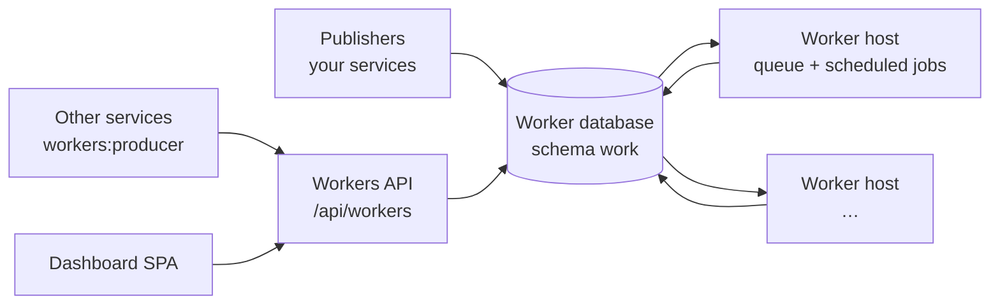

# ⏱️ Indice Workers

*Owned background jobs, queues & distributed locks — with an operations dashboard.*

Indice Workers runs the work an application should not do inside a request. **Jobs** are the base unit: each one is a
plain C# class with a trigger — a **queue** (run once for every message) or a **schedule** (run on a cron expression).
The product handles everything around the job: it hands each message to exactly one worker, retries failures and sets
aside the messages that keep failing, keeps state between scheduled runs, and uses **distributed locks** so that a
task runs once however many instances are deployed. A dashboard shows the queues, tasks, locks and workers, and lets
operators requeue, edit or delete messages, pause a schedule, run a task now, and release a stuck lock.

- **Queues, schedules and locks together** — one registration model, one store and one dashboard for all three.
- **Inside your application** — the worker is a hosted service in any ASP.NET Core or generic host, and the queues
  are tables in the application's SQL Server or PostgreSQL database; there is no broker to add.

### 🌍 Where it fits

- **Work off the request path** — emails, exports, webhooks, calls to slow systems: the API enqueues and answers; a worker does the rest.
- **Recurring jobs** — ETL pipelines, clean-ups, reports, reconciliations on a cron expression, with state kept between runs.
- **Clustered deployments** — ten instances of a service, one run of the nightly job: a singleton task takes a distributed lock.
- **Reliable hand-off** — a business row and the message about it are committed in the same transaction (outbox).
- **Service-to-service** — another service publishes to your queues over HTTP with a client-credentials token.
- **Under other Indice products** — Indice Messaging can run its delivery jobs on the same queues, in-process (`UseEventDispatcherHosting`).

| 📘 The product | 🛠️ For developers |
|---|---|
| 1. Core features & capabilities | 4. Architecture & hosting |
| 2. Flows | 5. Feature internals & integration |
| 3. Where Indice Workers shines | 6. Configuration |

---

## 🧰 1. Core features & capabilities

### ⚡ Jobs — the base unit

Everything a worker runs is a job: a handler class plus the trigger that decides when it runs.

- **Handler** — any class with a `Process` method. No base class, no interface.
- **Arguments by type** — the message or the task's state, a cancellation token and any registered service are
  passed to `Process`.
- **Two triggers** — a queue, or a schedule.

> A job is "this class, run for every message of that queue" or "this class, run on that schedule" — nothing else to learn.

### 📥 Queues & messages

- **Typed queues** — one queue per message type.
- **Delayed messages** — a message can be published now and become visible later.
- **Competing consumers** — any number of workers share a queue; each message goes to exactly one of them.
- **Four statuses** — **Enqueued** (waiting), **Scheduled** (delayed), **Retrying** (failed, waiting again), **Poison**.

### 🔁 Retries & the poison queue

- **Retries** — a message whose handler fails goes back to its queue, a configurable number of times.
- **Poison queue** — after the last retry the message moves aside, so one bad message never blocks the queue.
- **Recoverable** — an operator requeues a poison message as it is, or fixes its payload first.
- **Watched** — a health check reports poison messages above a threshold.

### 🗓️ Scheduled tasks

- **Cron schedules** — each task has a cron expression, a name, a group and a description.
- **State between runs** — a task can keep a state object that is loaded before each run and saved after it,
  e.g. an ETL watermark.
- **Run record** — last and next run, run count, the worker that ran it and the last error.
- **Singleton** — a task can be limited to one node at a time, however many nodes host it.
- **Enable / disable** — a disabled task skips its scheduled runs; nothing is redeployed.
- **Run now** — an operator requests one run outside the schedule; it also works on a disabled task.

### 🔒 Distributed locks

The lock that keeps singleton tasks to one node is also available to your own code, as `ILockManager`.

- **Named locks** — take a lock by name, or find out that someone else holds it.
- **Leases** — a lock is renewed while the work runs and expires on its own if its holder dies.
- **Exclusive run** — run a piece of code only while holding the lock; it is cancelled if the lock is lost.
  This also covers leader election.
- **Stores** — the database, Azure Blob Storage, in-memory for a single node, or your own.
- **Visible** — the dashboard lists the database locks and can release one left behind.

### 📤 Publishing work

- **In process** — any service of the application enqueues a message with one call.
- **Transactional outbox** — the message is saved together with your business data, in the same transaction: both
  are committed or neither is.
- **Publish-only hosts** — a service can publish to the queues without processing them.
- **Over HTTP** — other services publish through the API with their own narrow permission (`workers:producer`).

### 🖥️ Servers & live topology **(next release)**

- **Registration** — each worker registers on startup with its machine, application and version.
- **What it hosts** — the queues it consumes and the scheduled tasks it runs, with their settings.
- **Heartbeat** — a worker that stops removes itself; a crashed one is removed by its peers.
- **What this makes visible** — queues no live worker consumes, settings that differ between nodes
  (a rolling deployment), and scheduled tasks that have never run.

### 📊 Metrics & health

- **Metrics** **(next release)** — throughput, failures, handler time and queue wait time per queue; runs and run
  duration per task. Exported with OpenTelemetry.
- **Dashboard figures** **(next release)** — the same numbers per queue, per server and per task, for the last minute.
- **Health checks** — poison messages above a threshold; tasks that run too long or miss their schedule.

### 🖥️ Dashboard UI — Angular SPA

An operator surface, served embedded from an ASP.NET Core host.

- **Dashboard** — counters (enqueued, scheduled, retrying, poison, tasks, running, failing, active locks), messages per
  minute, a live queue-depth chart, the busiest queues and the tasks that need attention.
- **Queues** — one row per logical queue (`orders` and `orders-poison` are one row): a counter per status, the age of
  the oldest waiting message, throughput and settings. **Add message** enqueues into any queue.
- **Queue & message detail** — messages by status with search; select to **requeue** or **delete**; open a message to
  see attempts, visibility date and the JSON payload; **Edit & requeue** a poison message.
- **Scheduled tasks** — cron, last run and outcome, next run, run count, an **Enabled** switch and **Run now**; the
  detail page adds the handler, run durations, the full text of the last error and the persisted state.
- **Servers & locks** — live, stale and unknown workers with version, uptime, queues, tasks and throughput; the locks
  with their expiration and a **Release** action.
- **Live** — pages refresh on their own and pause when the tab is hidden; light and dark themes.

### 🔐 Dashboard API & access

- **One API** — everything the dashboard does is also available as an HTTP API, documented in OpenAPI.
- **Two roles** — `WorkersReader` sees everything, `WorkersAdmin` can also change it.
- **Machine publishers** — a service with the `workers:producer` scope can enqueue messages, and nothing else.
- **The UI follows** — a reader does not see the actions they cannot use.

---

## 🔄 2. Flows

### 🔄 The life of a message

Whoever publishes it, a message follows the same road: stored, picked up by one worker, retried on failure, set aside
when it keeps failing.



A delayed message sits in the queue as **Scheduled** until its date. A message whose handler throws returns as
**Retrying**; after `MaxRetryCount` retries it becomes **Poison** and waits for an operator. Requeue makes it a new
message again: visible now, attempts reset, back in its original queue.

### 🔄 A scheduled run on a cluster

Every worker that hosts a task has the same cron trigger. What happens when it fires depends on two settings.



Without `Singleton`, every node runs the task. With it, the first node to take the lock runs and the others skip;
the lease is renewed while the handler works, and if it cannot be renewed the handler's `CancellationToken` is cancelled.

### 🔄 Run now, from the dashboard

The scheduler lives inside each worker, and the dashboard only talks to the database — so a run is requested, not called.



While the request waits the task shows **Run requested**, and asking again does not queue a second run. A singleton
task still takes its lock. A request no worker picks up within 10 minutes is discarded.

---

## ⭐ 3. Where Indice Workers shines

Two things set Indice Workers apart. The database you already run is the queue, the scheduler's memory and the lock
service, so background work adds no infrastructure and can share a transaction with your data; and what the workers
are doing is visible and correctable by an operator, not only by a developer with database access. The two pillars
below expand each.

### 🗄️ Your database is the broker

- **Nothing new to run** — queues, task state, locks and servers are four tables in schema `work`.
- **SQL Server or PostgreSQL** — the same API on both.
- **Transactional outbox** — a message commits with the business change that caused it, or not at all.
- **In your `DbContext` if you want** — the worker tables can live in your own context and your own migrations.
- **Scales with instances** — more workers and more dequeuers per worker share a queue without coordination.

### 🛠️ Operable from day one

- **See it** — queue depth, oldest message, retries, poison, task outcomes, locks, live servers.
- **Fix it** — requeue, edit the payload, delete, enqueue by hand, release a lock.
- **Control it** — disable a schedule, run a task now, without a deployment.
- **Guard it** — reader and admin roles, a separate sub-scope for machine publishers.
- **Watch it** — health checks for poison messages and stuck tasks; an OpenTelemetry meter for history and alerts.

---

# 🛠️ For developers

## 🏗️ 4. Architecture & hosting

- **Built on `Indice.Platform`** — `Indice.Hosting` (the engine), `Indice.Features.Workers.Server` (the API and health
  checks), `Indice.Features.Workers.UI` (the embedded SPA).
- **Standard foundations** — .NET hosted services, Quartz.NET, EF Core (SQL Server / PostgreSQL), ASP.NET Core Minimal
  APIs, Angular 20 with Tailwind 4 + daisyUI 5.
- **Reference template** — `Indice.Workers.Hosting` (`dotnet new indice.workers.hosting`): a worker, the API and the
  dashboard in one host, with two sample jobs.

### 🏗️ 4.1 High-level architecture

The engine and the dashboard never call each other. Both read and write the same tables.



### 🏭 4.2 What's deployed in production

- **Worker hosts** — any host that calls `AddWorkerHost()`, in as many instances as the load needs.
- **Dashboard host** — the API and the SPA; a back-office app of its own, or the worker host itself as in the template.
- **Publisher hosts** — services that only enqueue, into the database or over HTTP.
- **Data** — one SQL Server or PostgreSQL database, schema `work`: `QMessage`, `ScheduledTask`, `Lock`, `Server`.

### 🔧 4.3 Composition + reference template

```csharp
// Indice.Workers.Hosting/Program.cs + Extensions/WorkerExtensions.cs
builder.Services.AddWorkerHost(options => {
    options.UseStoreRelational(db => db.UseSqlServer(cfg.GetConnectionString("WorkerDb")));
})
.AddJob<SendEmailHandler>()
    .WithQueueTrigger<SendEmailCommand>(options => {
        options.QueueName = "send-email";
        options.MaxRetryCount = 3;
    })
.AddJob<ReportHandler>()
    .WithScheduleTrigger<ReportState>("0 0/5 * * * ?", options => {   // Quartz cron, seconds first
        options.Name = "report";
        options.Group = "samples";
        options.Singleton = true;           // one node at a time
    });

builder.Services.AddWorkersEndpoints();     // dashboard API over the same WorkerDb

var app = builder.Build();
app.UseWorkersUI(o => o.PathPrefix = "/");  // embedded SPA
app.MapWorkers();                           // /api/workers

public class SendEmailHandler(ILogger<SendEmailHandler> logger)
{
    public async Task Process(SendEmailCommand command, CancellationToken cancellationToken) { /* … */ }
}
```

A scheduled handler has the same shape, with the task's state in place of the message.

---

## 🧩 5. Feature internals & integration

### 📥 Jobs & queues

- **A scope per run** — every invocation gets its own DI scope, so a scoped `DbContext` behaves as it does in a request.
- **One statement** — a worker deletes the next visible row and reads it in the same statement, so workers never
  wait for each other and never get the same message.
- **Removed on dequeue** — the row is inserted again only when the handler throws. A process killed in the middle of
  a handler loses its message, so stop workers gracefully (`WaitJobsToCompleteOnShutdown`) and keep handlers idempotent.
- **Retries** — a retried message is visible again at once; after `MaxRetryCount` retries it goes to `{queue}-poison`.

### 🗓️ Scheduled tasks & locks

- **Record** — triggers live in memory and are rebuilt on every start; what is stored is one row per task, keyed by
  `{group}.{name}`, with the state as JSON and the last error.
- **Singleton** — a lock named after the task id: a 30-second lease, renewed every 20 seconds.
- **Run now** — the request is a message in a hidden queue. Only a worker that hosts the task claims it, and several
  pending requests are served by one run.
- **Force release** — after a lock is released from the dashboard its holder can no longer renew: a singleton task is
  cancelled at its next renewal and another worker can take over. Azure and in-memory locks are not listed.

### 🌐 The dashboard API

- **Database only** — the API never calls a worker, so it runs on any host that can reach the database. Its reads
  do not block the workers; counters may be slightly off while messages move.
- **No history** — a processed message is deleted, so there is no "succeeded" list. Export the meter to your
  monitoring system for history and alerts.
- **Servers** **(next release)** — each worker keeps a row with a heartbeat; its peers remove it once it has clearly
  stopped. A database without the table only costs the server list.

| Policy | Routes under `/api/workers` |
|---|---|
| `BeWorkersReader` | every `GET`: `me`, `stats`, `queues`, messages, `scheduled-tasks`, `locks`, `servers` |
| `BeWorkersProducer` | `POST queues/{name}/messages` |
| `BeWorkersAdmin` | `PUT messages/{id}` · `POST messages/requeue` · `POST messages/delete` · `PUT scheduled-tasks/{id}/enabled` · `POST scheduled-tasks/{id}/run` · `DELETE locks/{id}` |

---

## ⚙️ 6. Configuration

| Section | What it controls |
|---|---|
| `ConnectionStrings:WorkerDb` | the worker database; the default of both `UseStoreRelational()` and `AddWorkersEndpoints()` |
| `General:WorkerHostDisabled` | `true` registers the queues for publishing but starts no consumer |
| `WorkerHostOptions` | store, lock manager, JSON, shutdown, run now, server heartbeat |
| `QueueOptions` · `ScheduleOptions` | per job: queue name, polling, instances, retries · task name, group, singleton |
| `WorkerEndpointsOptions` · `WorkerUIOptions` | API prefix, scopes, database · SPA path, API base, theme |

### 🧱 Worker host & jobs

```csharp
builder.Services.AddWorkerHost(options => {
    options.UseStoreRelational(db => db.UseSqlServer(connectionString));   // queues, task state and locks; or UseNpgsql(...)
    // options.UseStoreRelational<BankingDbContext>(...);                  // worker tables in your own context
    // options.UseLockManagerAzure();                                      // locks as Azure blob leases
    options.WaitJobsToCompleteOnShutdown = true;                           // default false
});
```

- **Queue defaults** — poll every 300 ms, backing off to 5 s while the queue is empty; 3 retries; one dequeuer per
  process (`InstanceCount`). Set `QueueName`: the default is a random name.
- **Name the task** — `{group}.{name}` is its id in the database, the dashboard and the lock table; renaming starts
  a new record.

### 📤 Publishing

```csharp
// In process
public class AlertService(IMessageQueue<Alert> queue)
{
    public Task Send(Alert alert) => queue.Enqueue(alert, visibilityWindow: TimeSpan.FromHours(1));
}

// Outbox: the message is saved with the order, in the same transaction
dbContext.AddAndEnqueue(order, new OrderCreated(order.Id));
await dbContext.SaveChangesAsync();

// Publish-only host
builder.Services.AddWorkPublisher(options => options.UseStoreRelational())
                .ForEvent<OrderCreated>("order-created");

// Another service, over HTTP
builder.Services.AddEventDispatcherHostingHttp((sp, o) => {
    o.BaseAddress = new Uri("https://workers.example.com/api");
    o.ClientId = "orders-service"; o.ClientSecret = "…";          // client credentials, scope workers:producer
});
```

- **Outbox requirement** — the worker tables live in your context: it implements `ITaskDbContext` and
  `ILockDbContext`, and the store is registered with `UseStoreRelational<BankingDbContext>()`.

### 🖥️ Dashboard & identity

- **Same database** — `AddWorkersEndpoints()` must point where the workers' store points.
- **Two paths, changed together** — the API prefix and the SPA's `ApiBase` are separate options.
- **API resource** `workers` — the scope `workers` with the `role` claim, and the scope `workers:producer` for
  services that publish over HTTP.
- **Client** `workers-ui` — authorization code + PKCE, no secret; redirect URIs `{host}{path}/auth-callback` and
  `{host}{path}/auth-renew`, post-logout `{host}{path}/logged-out`.
- **Roles** — `WorkersReader` and `WorkersAdmin`; `Admin` passes everything.

### 🩺 Health checks & metrics

```csharp
builder.Services.AddHealthChecks()
    .AddWorkerPoisonMessages(configure: o => o.Threshold = 10)
    .AddWorkerStuckTasks(configure: o => o.StuckAfter = TimeSpan.FromHours(2));   // both report Degraded by default

builder.Services.AddOpenTelemetry()
    .WithMetrics(metrics => metrics.AddMeter(WorkerDiagnostics.MeterName));       // (next release)
```

### 🗄️ Databases & migrations

- **One context** — the built-in `TaskDbContext`, or your own with `ApplyWorkerConfiguration(Database.ProviderName)`
  in `OnModelCreating`; the tables then travel with your migrations.
- **Upgrade scripts** — index and table changes between versions ship as SQL Server and PostgreSQL scripts in the
  `Indice.Hosting` changelog.

### 🧰 Extensibility

```text
ILockManager                   your own lock store, or your own critical sections
IMessageQueue<T>               your own queue store for one job
IScheduledTaskStore<TState>    where scheduled-task state is kept
IQueueNameResolver<T>          how a work item type maps to a queue name
IEventDispatcher               publish through the dispatcher abstraction, in process or over HTTP
WorkerUIOptions.HeadContent    a stylesheet with your own dashboard theme
```
